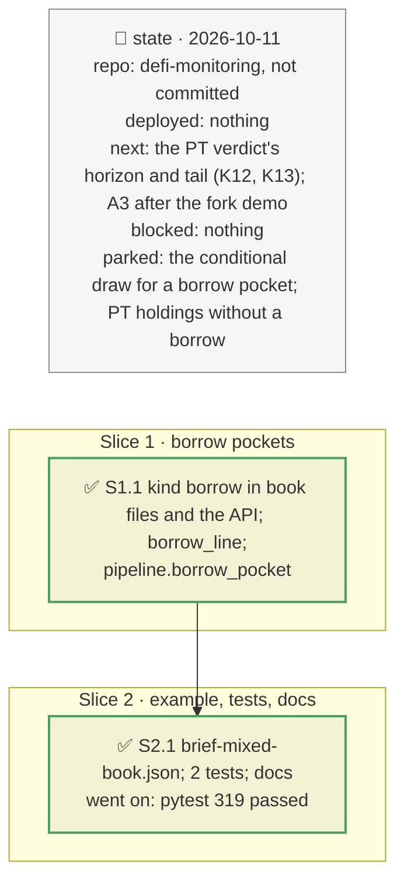

# The brief's book with its own PT loop, plan

> **Status**: approved: the person, 2026-10-11, "Make the relevant improvement, keep focus on hackaton_instruction" (`NEXT_STEP.md` A6, the book part; and the finding that a known incident needs no hack probability). No interview: the decisions below are the agent's defaults.
> **Delivers**: a book can hold a Morpho Blue borrow next to its vaults, as the brief's book of pockets holds its worked example; one incident (`token=X:f`) reaches it when X is the position's collateral or underlying, and its line follows the same rule as a vault pocket (the loss avoided against the certain cost of leaving, p\*, a reason). Proof: `examples/brief-mixed-book.json`, nine vault pockets and the PT-sUSDe loop, under sUSDe −8 % with an 11 % unwind: the loop's pocket loses 776,708 of 1,000,000; leaving costs 110,000: EXIT. The docs state that the hack priors feed only `analyze --demo`'s ex-ante view.
> **Hard rule**: no new data (the borrow comes from the analyze snapshot); the vault path unchanged; `web/` untouched; the agent never commits.
> **Read against**: the brief's worked example (`GOAL.md`: ten pockets, one hit, 11 % to unwind); plans `2026-10-11-judge-path` (D152–D153), `2026-10-10-incident-mode` (D89–D90).
> **Left out**: §4 Flows and §5 State.

## The tracker

mandate: mode classic · no git, the person commits · inline · tests at the slice end · verify off

# Design

## 1. Why, and why not

The brief's worked example is a book of pockets where one pocket, a leveraged PT position, is hit. The tool had the PT position (`analyze`) and books of vaults, but not the one inside the other. And the brief starts from a known incident: no hack probability enters any known-incident answer; the hack-history priors (`priors.py`) feed only `analyze --demo`'s ex-ante simulation, the secondary view. The docs now say so, and the priors' gaps (`GAP.md` K1–K5, K15, K17, K18) are demoted accordingly.

**Non-goals**: the PT verdict's horizon to maturity and tail budget (K12, K13: next); the conditional distribution for a borrow pocket; a PT held without a borrow.

## 3. Modules, after

- **`vault_book.py`**: `BookVault.kind`; `parse` accepts `{"kind": "borrow", "market": …, "user": …}`; `borrow_line` (pure); `aggregate(..., extra, extra_names)`; "pocket(s)" in a pocket book's headline.
- **`pipeline.py`**: `borrow_pocket`: discover the position, map the token shock, run `analyze`'s incident, build the line.
- **`api/schemas.py`**: `BookVaultIn.kind`; `openapi.json` regenerated.
- **`examples/brief-mixed-book.json`**.

## 8. Decisions

| id | Kind | Decision | Status | Source | Slice |
|---|---|---|---|---|---|
| D177 | contract | A book pocket can be a Morpho Blue borrow: `kind: "borrow"`, the market id, the borrower (`user`, kept as spelled: the recording is keyed by it). A token shock that names its collateral or the collateral's underlying is, for the position, a loss of backing every oracle sees (`issuer_hack` at the same fall) | agreed, agent's default | `propagate.py` | S1 |
| D178 | contract | A borrow pocket's line follows the vault pocket's rule: staying loses the incident's loss; leaving now avoids it and costs the exit (its swap quote, or `--exit-cost` × the pocket); EXIT when the loss avoided exceeds that cost; p\* and a one-clause reason; scaled to the pocket's amount in the `pocket` weighting | agreed, the brief's trade-off | D152–D153 | S1 |

# Execution

## 9. The slices

| Slice | Done when | Went on |
|---|---|---|
| S1 | the mixed book runs offline | the borrower lower-cased missed the snapshot's recording: kept as spelled |
| S2 | the CLI and the API; 319 tests pass | — |

## Interview log

No interview: the person asked for the relevant improvement, focused on the brief.
