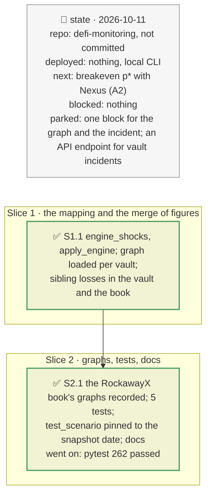

# One incident, one number, plan

> **Status**: approved: the person, 2026-10-11, "Yes go for it" (step A0 of `docs/analysis/NEXT_STEP.md`, after the shock engine was merged). No interview: the decisions below are the agent's defaults.
> **Delivers**: `analyze --vault` / `--book` runs the shock engine (plan `2026-10-10-propagation-engine`) on each vault's recorded dependency graph, so a markdown gets the same figure from both commands, plus the engine's squeeze and the sibling markets the same incident reaches. Proof: PRIME −30 % on RockawayX USDC Yield, 131,162 USDC from both paths; strUSD −30 % rises from 568k to 876k once the engine prices the liquidation sales.
> **Hard rule**: no new provider; the engine and its rules are used as they are; what the engine cannot express (a borrower default, a Pharos-reached market) keeps this module's figures; the agent never commits.
> **Read against**: plans `2026-10-11-vault-incident`, `2026-10-11-vault-book`, `2026-10-11-borrower-concentration`, `2026-10-11-pharos`; `docs/model/shock-engine.md`.
> **Left out**: §4 Flows and §5 State: one more pure step in an existing one-shot computation.

## The tracker

mandate: mode classic · no git, the person commits · inline · tests at the slice end · verify off

# Design

## 1. Why, and why not

Two commands priced the same incident: `analyze --vault` (verdict, exit queue, book, defaults, Pharos) and `shock` (the graph, sibling markets, sale impact from real Pendle quotes). On RockawayX USDC Yield they gave 122.8k and 131.2k for "PRIME −30 %". The gap was not a model error: `shock … PRIME:price:-30%` is a market fall the issuer's rate feed does not follow, while `token=PRIME:0.30` is the issuer cutting that rate. Mapped correctly, both give 131,162. One mapping, and one source of figures, removes the question "which number is right".

**Non-goals**: a verdict inside `shock` (its step 2, to be agreed with its author); defaults and oracle failures (`reads-high`, `frozen`) in `analyze --vault` (`shock` has them); the graph and the incident read at one block.

## 3. Modules, after

- **`vault_incident.py`**: `engine_shocks` (pure), `apply_engine`; `run(..., graph=)`; `MarketHit.source`, `engine`; `VaultIncident.engine_block`, `sibling_losses`.
- **`vault_book.py`**: the sibling markets' losses across the book, each counted once.
- **`cli.py`**: `_vault_graph(vault)`, the recorded graph or None, with the clock put back.
- **`fixtures/replay/graph-<vault>/`**: the five RockawayX vaults that had no graph.
- **`tests/test_scenario.py`**: the `demo` fixture sets the clock to the snapshot's date (it failed once the date rolled over, on `HEAD` too).

## 8. Decisions

| id | Kind | Decision | Status | Source | Slice |
|---|---|---|---|---|---|
| D139 | contract | A markdown `token=T:f` becomes, in the engine: T `price` −f, and `reads-low` f on every constant-price input (the issuer's rate or NAV feed) of the oracles of markets taking T as collateral. A price-tracking input follows T through the graph's `tracks` edges. A `converts through` input is not shocked | agreed, checked: PRIME −30 % gives 131,162 from both paths | `docs/model/shock-engine.md` | S1 |
| D140 | contract | When the vault has a recorded graph, the engine's liquidated debt and lenders' loss replace this module's on every market of the vault it moves; a hit reached only through a borrower default or Pharos keeps this module's figures; a market of the vault only the engine reaches becomes a hit. The hit says which, with the engine's oracle and market factors and what was left insolvent | agreed, agent's default | — | S1 |
| D141 | contract | The sibling markets the engine reaches, which the vault does not supply, are listed as "contagion beyond this vault" (lenders' loss, in their loan token); the book counts each once. Without a recorded graph, a note says so and the module's figures stand | agreed, agent's default | — | S1 |

# Execution

## 9. The slices

| Slice | Done when | Went on |
|---|---|---|
| S1 | PRIME −30 % equal from both paths; strUSD −30 % explained (squeeze: 0 liquidated, 2.43M insolvent) | strUSD first looked like a mapping error; the engine was right: its liquidation sales push strUSD's market to × 0.615 |
| S2 | the book's graphs recorded; the suite passes | `test_scenario` failed on `HEAD` as well once the date rolled over: its fixture read the wall clock |

## Interview log

No interview: the person approved A0 after the comparison of the two commands.
