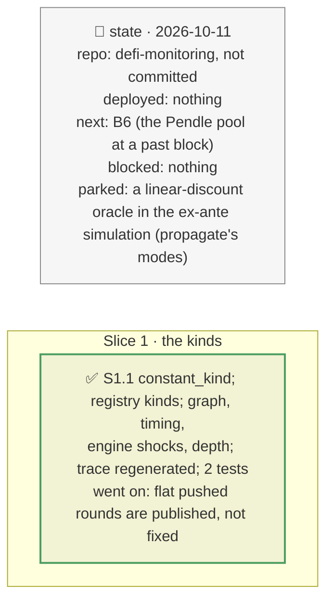

# Constant-price oracles split by kind, plan

> **Status**: approved: the person, 2026-10-11, "Implement B4" (`NEXT_STEP.md` B4, its rest). No interview: the decisions below are the agent's defaults.
> **Delivers**: every constant-price oracle and input carries its kind, how it moves when the issuer loses value: an exchange rate at once, a published value at its next round, a linear discount or a fixed value never. A markdown reaches the engine only through the kinds that move, so a market priced by a linear discount liquidates nobody and its lenders hold the shortfall (and the drain the gap opens): drain priority by class, through the engine. The kind shows in `graph`, the shock trace, incident timing and the PT report's discovery depth.
> **Hard rule**: offline, from the reads the classification already makes (no new call); rules in `registry.json`; `web/` untouched; the agent never commits.
> **Read against**: `docs/hackaton_instruction/GOAL.md` (oracle and feed-quality analysis; impact 30 %); `docs/analysis/GAP.md` K7; plans `2026-10-10-sibling-markets` (D82–D84), `2026-10-11-one-number` (D139), `2026-10-10-drain-threshold`.
> **Left out**: §4 Flows and §5 State.

## The tracker

mandate: mode classic · no git, the person commits · inline · tests at the slice end · verify off

# Design

## 1. Why, and why not

"Constant-price" put four behaviours under one name, and a markdown made every one of them read low, including a PT's linear discount, which never moves. The sponsor's vaults are mostly issuer-published NAVs and Pendle PTs: the kind decides how fast the loss lands, who bears it, and whether leaving first helps. **Non-goals**: the ex-ante simulation's oracle modes (`propagate.py`), left as they are.

## 8. Decisions

| id | Kind | Decision | Status | Source | Slice |
|---|---|---|---|---|---|
| D205 | contract | A constant-price input has a kind (`oracle_class.constant_kind`): an ERC-4626 share or a rule saying so is an exchange rate; a pushed round history, even flat so far, is published (the next round can carry a loss); exactly 1.0 with no round, or no base input, is fixed; otherwise the rule's `kind` (`registry.json` `graph.oracle_getters` and `oracle_patterns`). Several parts priced together take the fastest. A markdown reaches only the exchange-rate and published inputs (D139 narrowed): a linear-discount or fixed oracle keeps reading, the market liquidates nobody, its lenders hold the shortfall and the drain the gap opens | agreed, agent's default | D82–D84, D139 | S1 |

# Execution

## 9. The slices

| Slice | Done when | Went on |
|---|---|---|
| S1 | the kinds read offline on the recorded graphs; 337 tests pass | on RockawayX USDC Yield's graph: 2 linear-discount PT markets (PT-trUSD, PT-strUSD), RedStone fundamental and Midas feeds published, ERC-4626 and reUSD rates exchange rates. A 30 % PT-trUSD markdown: its sibling market's lenders lose 416,159 USDC with nobody liquidated (405k before, through liquidations that could not happen) |

## Interview log

No interview: the person asked for B4.
