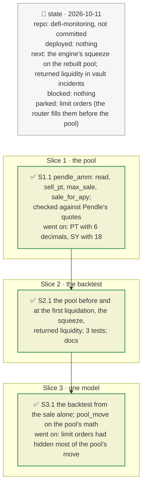

# The Pendle pool at a past block, plan

> **Status**: approved: the person, 2026-10-11, "Implement next step" (`NEXT_STEP.md` B6). No interview: the decisions below are the agent's defaults.
> **Delivers**: a Pendle V2 pool rebuilt from its on-chain state at any block (`pendle_amm.py`: Pendle's own market math), checked against Pendle's quotes; in the PT-reUSD backtest, the pool behind the oracle's fall: its implied APY before and at the first liquidation, the PT sold into it, the sale the pool's math needs from the state before, and the squeeze (what the pool still accepted against what the liquidations seized); the debt repaid as liquidity returned to the markets.
> **Hard rule**: offline from recordings (the pool's state read once through the archive route, cached under the public URL, no key); `web/` untouched; the agent never commits.
> **Read against**: `docs/hackaton_instruction/GOAL.md` (impact 30 %: "is the number defensible"); `docs/analysis/GAP.md` K8, K9, K27; plans `2026-10-11-backtest`, `2026-10-11-pool-move`; `pendle-core-v2-public` `MarketMathCore.sol`.
> **Left out**: §4 Flows and §5 State.

## The tracker

mandate: mode classic · no git, the person commits · inline · tests at the slice end · verify off

# Design

## 1. Why, and why not

The backtest applied the oracle's observed fall: it tested impact given the incident, but could not say where the fall came from, and the quote API answers for now only. Pendle's pool math is public and its state is on-chain, so the pool can be rebuilt at any block. **Non-goals**: limit orders (off-chain books the router fills before the pool; they do not move the pool's implied rate); the TWAP's path block by block (the oracle's observed prices already are the shock).

## 8. Decisions

| id | Kind | Decision | Status | Source | Slice |
|---|---|---|---|---|---|
| D207 | contract | `pendle_amm.sell_pt`: Pendle V2's `MarketMathCore` in floating point: rate scalar, anchor from the last implied rate, the exchange rate at the post-trade proportion (refused above 96 %), the fee rate, the reserve's share, and the new implied rate. Amounts in PT units (the PT's decimals; SY's 18 converted by its rate). Checked against Pendle's pool-only quotes on the demo pool at one block: 1e-9 at 1,000 PT, 1e-5 at 10,000 (beyond, the router also fills limit orders) | agreed, agent's default | `MarketMathCore.sol` | S1 |
| D208 | contract | An episode may name the Pendle pool its oracle's TWAP reads (`backtest.episodes.<name>.pendle_market`): the pool is read before the episode and at the first liquidation; the report gives the APY move, the PT sold into the pool and what it paid out, the sale the pool's math needs from the state before to reach that APY, and the squeeze: the PT the pool still accepted at the first liquidation against the PT the liquidations seized. The debt the liquidators repaid is shown as liquidity returned to the markets | agreed, agent's default | D161–D164 | S2 |
| D209 | contract | `pendle_amm.read`: `readState(RouterV4)`, `readTokens()`, the SY's `exchangeRate()`, the YT's `pyIndexStored()` (the index is the larger), the PT's `decimals()` and the block's timestamp, in two batches and one block read; an old block through the archive route, recorded | agreed, agent's default | D161 | S1 |
| D210 | contract | The backtest also predicts from the sale alone: the PT sold into the pool between the block before and the first liquidation, sold into the pool as it stood before, gives the PT's price fall (the rate the oracle's TWAP reads, the move assumed held through its window); each market's oracle is set that much below its price before, and the liquidation model runs again. Reported next to the prediction from the observed fall | agreed, the person: "Implement 1 and 2" | D162–D163 | S3 |
| D211 | contract | `analyze --shock pool_move` prices the sale by the pool's math on its state at the snapshot's block (recorded through the archive route), replacing the API quotes of D204, which include the router's limit orders: the pool's new implied rate, the rise added to `pt_yield`, the sale that reaches the position's liquidation fall (`sale_for_apy`), or the largest sale the pool accepts and its fall | agreed, the person: "Implement 1 and 2" | D204 | S3 |

# Execution

## 9. The slices

| Slice | Done when | Went on |
|---|---|---|
| S1 | the pool math matches Pendle's quotes on a recorded block | PT-reUSD's PT has 6 decimals and its SY 18: amounts scaled by the PT's decimals |
| S3 | the backtest predicts from the sale; the demo's pool move runs offline on the pool's math | from the sale alone the oracle falls 2.36 % (observed 2.45 % and 2.76 %): the same 13 and 7 borrowers, none missed, none extra. The demo pool accepts at most 2.69M USD of PT (96 %), moving it 0.87 %; half its liquidity moves it 0.48 %, where the API's quotes, filling limit orders first, gave 0.06 % |
| S2 | the backtest replays the pool offline; 343 tests pass | from the state 60 blocks before, the pool's math needs 5.52M PT to lift the implied APY from 10.58 % to 20.37 %; the pool took 5.43M (+1.7 %) and paid 5.21M (model −0.2 %). At the first liquidation it accepted only 309k more PT; the liquidations seized 38.6M |

## Interview log

No interview: the person asked for the next step.
