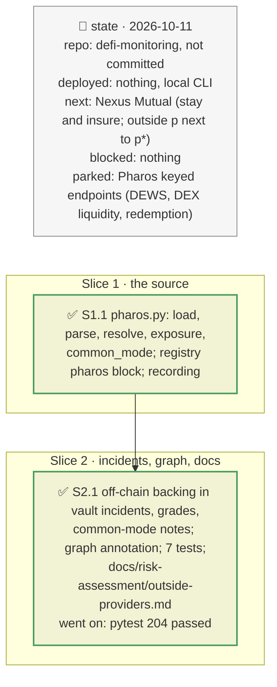

# Pharos, keyless, plan

> **Status**: approved: the person, 2026-10-11, "Ok implement the use of pharos without API key. Add a document which explain on how this provider (and nexus will be the next…)". No interview: the decisions below are the agent's defaults.
> **Delivers**: incidents and graphs read Pharos's public dependency graph: each covered asset's grade, the off-chain backing a token shock also travels through, and the narrow common-mode groups a shocked token shares with other collateral. Proof: on the RockawayX book, an fxSAVE cut now reaches the siUSD market of RockawayX USDC Yield, because fxSAVE backs 16.4 % of infiniFi's iUSD; `docs/risk-assessment/outside-providers.md` explains the provider.
> **Hard rule**: keyless only; optional (a failure prints "Pharos: not checked"); a grade is shown, never used as a number; responses recorded under `fixtures/replay/pharos/`; the agent never commits.
> **Read against**: `docs/analysis/EXTERNAL_SOURCE.md` §2 and §6 (the survey); plans `2026-10-11-wrapped-collateral` (D126–D127) and `2026-10-11-borrower-concentration`.
> **Left out**: §4 Flows and §5 State: one cached read, then pure functions.

## The tracker

mandate: mode classic · no git, the person commits · inline · tests at the slice end · verify off

# Design

## 1. Why, and why not

On-chain look-through stops where a token's backing leaves the chain: a reserve held by the issuer, a basket of other protocols' tokens. Pharos publishes that backing for stablecoins and yield dollars, with weights, and the groups of coins that share one mint key or admin. That is dependency discovery the brief weighs at 30 %, from a keyless source.

**Non-goals**: grades as probabilities (B5 of `NEXT_STEP.md`, with a stated mapping); the keyed endpoints; Pharos's modelled scenarios (score changes, not losses).

## 3. Modules, after

- **`pharos.py`**, new. Pure: `parse`, `resolve`, `name`, `exposure`, `common_mode`, `Snapshot.grade`. I/O: `load` (cached fetcher, None on failure).
- **`vault_incident.py`**: `pharos_reach`, `graded` (pure); `run(..., pharos=)`; `MarketHit.grade`, `pharos_exposure`; `VaultIncident.pharos`, `common_mode`.
- **`vault_book.py`**: notes for the common-mode groups and the grades of the hit collateral.
- **`graph.py`**: `annotate_pharos`.
- **`cli.py`**: `_pharos(args)`, used by `analyze --vault|--book` and `graph`.
- **`registry.json`**: `pharos` (address map, `min_exposure`, group kinds and width, basis).

## 8. Decisions

| id | Kind | Decision | Status | Source | Slice |
|---|---|---|---|---|---|
| D133 | module | One keyless request, `GET /api/dependency-graph/v1`, slimmed before caching to node grades and backing, and group kind, key and members | agreed, agent's default: its nodes carry the grades, so `safety-grades` is not needed | `EXTERNAL_SOURCE.md` §2 | S1 |
| D134 | contract | A token resolves to a Pharos id by the registry's address map, then an exact id, then the only id whose first part is its symbol; ambiguous symbols (three iUSD, two reUSD) need the map | agreed, agent's default | — | S1 |
| D135 | contract | A token shock also reaches a market whose collateral, or a token it wraps on-chain, is backed off-chain by the shocked token: fall = shock × Σ over paths of the product of the backing weights (cap 1, depth 4), ignored below `pharos.min_exposure` (1 %). The market is treated as wrapped collateral (D127): seen only if its oracle tracks a market price, else a hidden shortfall. On-chain matches take precedence | agreed, agent's default; pro-rata pass-through stated as an upper bound for tokens with a junior tranche | — | S2 |
| D136 | contract | Grades are shown (hit lines, book notes, graph details) with the publication date, and never enter a loss | agreed, the survey's caution: a grade is not a probability | `EXTERNAL_SOURCE.md` §2 limits | S2 |
| D137 | contract | Common-mode groups: only `mint-control`, `upgrade-control`, `reserve-issuer`, `redemption-rail` with at most `pharos.max_group_members` (12) members; a note names the vault's collateral sharing one with the shocked token; the graph links assets sharing one to an External node | agreed, agent's default: chain and DEX groups hold up to 202 coins | — | S2 |
| D138 | module | Recorded under `fixtures/replay/pharos/`: offline by default, re-read by `--record`/`--refresh`, read without saving by `--live`; a failure prints "Pharos: not checked" and the run goes on | agreed, agent's default | `CLAUDE.md` fixtures rule | S2 |

# Execution

## 9. The slices

| Slice | Done when | Went on |
|---|---|---|
| S1 | the snapshot records and loads offline; iUSD's exposure to fxSAVE is 16.4 % | — |
| S2 | the RockawayX book under fxSAVE −30 % hits two vaults; trUSD's common mode with strUSD noted; the recorded graph annotated; 204 tests pass | the shocked token was named by its Pharos id where it matched only through Pharos: the registry's address map gained symbols |

## Interview log

No interview: the person asked for the keyless use of Pharos and a document explaining the provider.
