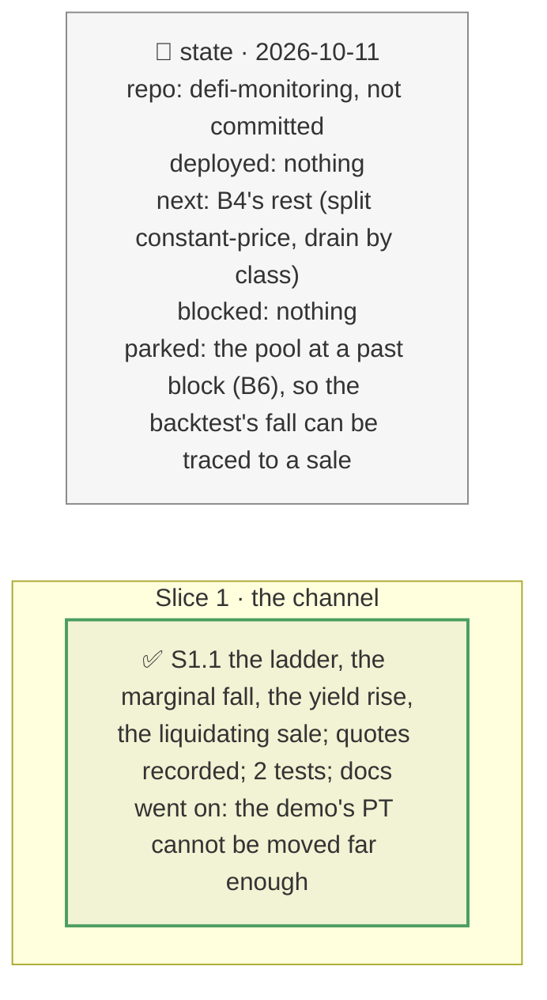

# The pool move as a loss channel, plan

> **Status**: approved: the person, 2026-10-11, "Next step now" (`NEXT_STEP.md` B4, its first part). No interview: the decisions below are the agent's defaults.
> **Delivers**: `analyze --shock pool_move=<x>`: a sale of x times the pool's liquidity of the PT into its Pendle pool (a looper unwinding, a whale, a manipulation), measured on real pool-only quotes, priced through the oracle as the implied-yield rise it amounts to; with the sale that would liquidate the position, or the largest sale the pool routes and how far it moves the price.
> **Hard rule**: offline from the analyze snapshot (the ladder's quotes are recorded in it); no new provider (the Pendle swap quote `discover.quote_ladder` already uses); `web/` untouched; the agent never commits.
> **Read against**: `docs/hackaton_instruction/GOAL.md` (impact 30 %: "is the number defensible"); `docs/analysis/GAP.md` K8; plans `2026-10-11-backtest`, `2026-10-11-pt-channels`, `2026-10-10-propagation-engine` (D112–D113, the ladder).
> **Left out**: §4 Flows and §5 State.

## The tracker

mandate: mode classic · no git, the person commits · inline · tests at the slice end · verify off

# Design

## 1. Why, and why not

K8: a trade into a thin Pendle pool moved a TWAP oracle and liquidated 33 positions on PT-reUSD, with no incident anywhere else. The backtest replays the oracle's fall; nothing priced the sale behind it. **Non-goals**: the pool at a past block (B6); the seller's motive.

## 8. Decisions

| id | Kind | Decision | Status | Source | Slice |
|---|---|---|---|---|---|
| D204 | contract | `pool_move=<x>`, x the sale in multiples of the pool's liquidity (0 < x ≤ 5, the ladder's largest): pool-only Pendle quotes (no aggregator: the TWAP reads the pool) at the engine's ladder sizes and at x; the pool's price fall is the marginal price after the sale (`discover.marginal_curve`), turned into the implied-yield rise that gives it (the inverse of `pt_fall`), added to `pt_yield`, so the oracle's class, a meta-oracle's switch and the verdict apply as for a yield rise. Also the sale that moves the price by the position's liquidation fall, or the largest sale the pool routes and its fall; a sale above it counts as it. The move must hold through the oracle's window: said, not modelled | agreed, agent's default | D112–D113, D169 | S1 |

# Execution

## 9. The slices

| Slice | Done when | Went on |
|---|---|---|
| S1 | the demo runs offline with the move | 47 days from maturity, the largest sale the pool routes (3.82M USD) moves the PT 0.70 %, short of the 5.16 % that liquidates the position; Pendle refuses 5.73M. The quotes were taken 2026-10-11, a day after the snapshot |

## Interview log

No interview: the person asked for the next step.
