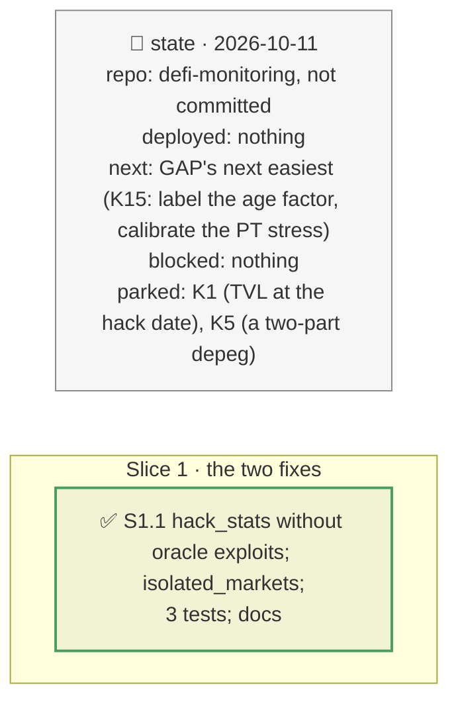

# Oracle exploits counted once; Morpho Blue's core prior, plan

> **Status**: approved: the person, 2026-10-11, "What could/should be implemented from GAP.md? Start with the two easiest points" (GAP K3 and K4). No interview: the decisions below are the agent's defaults.
> **Delivers**: the hack-record frequency model counts an oracle exploit once, in the oracle layer, no longer also in its protocol's category; Morpho Blue's exploit prior drops the Lending category multiplier, whose rate comes from pooled forks with spot-price oracles, a risk its isolated markets carry per market through the oracle layer. Morpho Blue 5.03 % → 2.50 %/yr; the demo's expected loss 6,265 → 5,671 USD.
> **Hard rule**: offline from the snapshot; the ex-ante view only (no known-incident answer uses the priors); the agent never commits.
> **Read against**: `docs/analysis/GAP.md` K3, K4; `docs/model/how-probabilities-are-computed.md`; plan `2026-10-10-defi-risk-dependency` (D9, the frequency model).
> **Left out**: §4 Flows and §5 State.

## The tracker

mandate: mode classic · no git, the person commits · inline · tests at the slice end · verify off

# Design

## 1. Why, and why not

Both over-state the ex-ante view's frequency, and both are fixed in the data the model already reads. **Non-goals**: the rest of B5 (survivorship, the window, the depeg tail).

## 8. Decisions

| id | Kind | Decision | Status | Source | Slice |
|---|---|---|---|---|---|
| D232 | contract | `priors.hack_stats` leaves out of the category and tier counts every hack whose technique is one of `oracle.techniques` (the oracle layer's own count), and reports how many per category (`oracle_moved`); the exploit note says so. On the snapshot: 4 in the window (3 Lending, 1 Yield Aggregator); the top band's rate 2.66 % → 2.50 %/yr | agreed, agent's default | GAP K3 | S1 |
| D233 | contract | A protocol flagged `isolated_markets` in `registry.json` `protocols` (Morpho Blue) gets the TVL band's rate without the category multiplier: the category's rate comes from pooled forks with spot-price oracles, a market-configuration risk its markets carry each through the oracle layer; stated in `isolated_basis` with the anchors (no core exploit recorded; Credora 0.13 %/yr) | agreed, agent's default | GAP K4 | S1 |

# Execution

## 9. The slices

| Slice | Done when | Went on |
|---|---|---|
| S1 | the demo replays with the new priors; 382 tests pass | Morpho Blue 5.03 % → 2.50 %/yr, Ethena 1.33 % → 1.25 %, Pendle 1.21 % → 1.17 %; the demo's expected loss 6,265 → 5,671 USD, still REDUCE (the tail) |

## Interview log

No interview: the person asked for the two easiest points of GAP.
