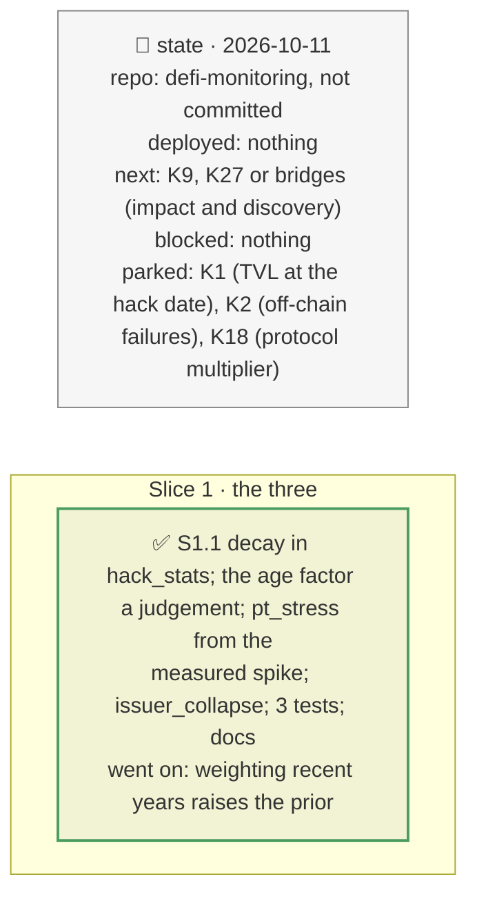

# The depeg tail, two sourced parameters, a recency-weighted window, plan

> **Status**: approved: the person, 2026-10-11, "Implement K15, K5 and K17". No interview: the decisions below are the agent's defaults.
> **Delivers**: in the ex-ante view (`analyze --demo`): hacks weighted by age (half-life 2 years); the age factor stated as a judgement; the PT's stress in a depeg from a measured implied-yield spike over its time to maturity instead of a flat ×1.5; a rare, near-total collapse for synthetic dollars next to the frequent wick.
> **Hard rule**: offline from the snapshot; no known-incident answer uses these priors; the agent never commits.
> **Read against**: `docs/analysis/GAP.md` K5, K15, K17; plans `2026-10-11-priors-k3-k4`, `2026-10-11-pendle-pool` (the measured spike); `docs/model/how-probabilities-are-computed.md`, `docs/model/monte-carlo.md`.
> **Left out**: §4 Flows and §5 State.

## The tracker

mandate: mode classic · no git, the person commits · inline · tests at the slice end · verify off

# Design

## 1. Why, and why not

Three of the ex-ante view's numbers had no basis or the wrong shape: a flat five-year window over a shifting attack mix, a depeg tail that could not reach a collapse, and two parameters stated without a source. **Non-goals**: the hack record's survivorship (K1) and off-chain failures (K2).

## 8. Decisions

| id | Kind | Decision | Status | Source | Slice |
|---|---|---|---|---|---|
| D234 | contract | `hack_stats` weighs each hack 2^(−age / `half_life_years`) (2) in the tier and category counts and the window's protocol-years the same (∫ over 5 years = 2.38 years), so a rate stays a rate; the oracle layer's count is weighted the same. On the snapshot the top band rises 2.50 % → 3.29 %/yr: recent years had more hacks | agreed, agent's default | GAP K17 | S1 |
| D235 | contract | The age factor stays (×2, ×1, ×0.7) and is labelled a judgement, in `age_factor_basis` and in each exploit note | agreed, agent's default | GAP K15 | S1 |
| D236 | contract | During a depeg a market-tracking oracle sees the PT at (1 − depeg) × (1 − PT stress), PT stress = 1 − ((1 + y) / (1 + y + spike))^T with `pt_stress_yield_spike` 0.098, measured on the PT-reUSD pool on 2026-08-25 (10.58 % → 20.37 %); also in `decide.stress_drop`; replaces `pt_stress_extra_discount` (×1.5). A 47-day PT: +1.1 %; one year: +8.5 % | agreed, agent's default | GAP K15, D208 | S1 |
| D237 | contract | An issuer of kind `synthetic-dollar` has `depeg.collapse`: 2 %/yr, severity Beta(6, 1.2) (mean 83 %), drawn as its own event and applied as a loss of backing every oracle sees (the deeper of it and the exploit); basis: USR −97 %, xUSD −77 %, deUSD ≈ 0 in 2025–2026, about 7 %/yr for the family, 2 %/yr a judgement for an established issuer with a reserve fund | agreed, agent's default; the rate is a stated judgement | GAP K5 | S1 |

# Execution

## 9. The slices

| Slice | Done when | Went on |
|---|---|---|
| S1 | the demo replays; 385 tests pass | Morpho Blue 3.29 %, Pendle 1.64 %, Ethena exploit 1.65 %, collapse 2 %/yr; the depeg's contribution 3,760 → 2,921 USD (a PT near maturity barely moves), the stress to survive 12.2 % → 9.2 %; the demo's expected loss 6,327 USD, still REDUCE |

## Interview log

No interview: the person asked for K15, K5 and K17.
