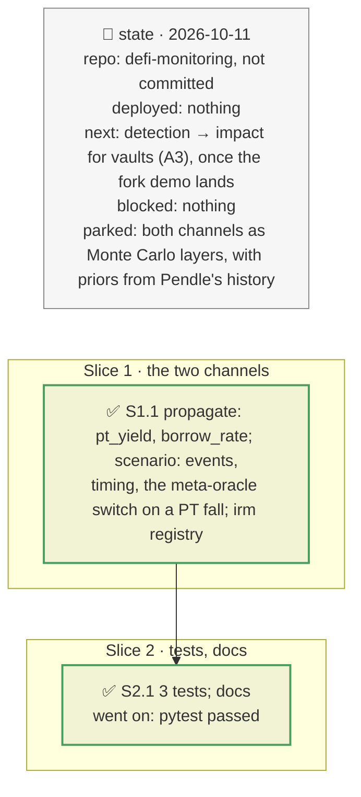

# The PT loop's yield and rate channels, plan

> **Status**: approved: the person, 2026-10-11, "Implement them if they are still relevant" (`IMPROVEMENT.md` 2.5, `NEXT_STEP.md` B1–B2; `GAP.md` K10 and K11 were open). No interview: the decisions below are the agent's defaults.
> **Delivers**: `analyze --shock pt_yield=<pts>` (the PT's implied yield rises) and `--shock borrow_rate=<APY>` (the borrow rate over the horizon), with their impact, time to impact and verdict on the brief's own example, a Pendle PT used as Morpho collateral. Proof on the demo: a 40 % borrow rate for 30 days costs $101,734, more than leaving ($78,946): EXIT; +30 pts of implied yield move the PT −3.15 % 47 days from maturity, inside the position's margin even after the meta-oracle's switch: STAY.
> **Hard rule**: pure additions to `propagate.loss` with neutral defaults (the Monte Carlo is unchanged); the AdaptiveCurveIRM constants in the registry; the agent never commits.
> **Read against**: `GAP.md` K10, K11; plan `2026-10-10-incident-mode` (D89–D97); the backtest (plan `2026-10-11-backtest`: an implied-yield spike liquidated 20 positions through a market-tracking oracle).
> **Left out**: §4 Flows and §5 State.

## The tracker

mandate: mode classic · no git, the person commits · inline · tests at the slice end · verify off

# Design

## 1. Why, and why not

A leveraged PT loop loses money with no issuer incident at all: its borrow rate can multiply when the market fills, and its PT's price falls when the implied yield rises. The second is what liquidated 20 positions on 2026-08-25 (the backtest). Both were open gaps of the brief's own worked example.

**Non-goals**: drawing them in the ex-ante Monte Carlo (needs priors from Pendle's implied-yield history and the market's utilisation history); the borrow rate's own path (the user gives the rate; the timing line says how fast the IRM gets there).

## 3. Modules, after

- **`propagate.py`**: `loss(..., pt_years, implied_apy, borrow_apy, horizon_years)`, the two events.
- **`scenario.py`**: `EVENTS` gains `pt_yield`, `borrow_rate`; `assess(..., horizon_days)`; `pt_fall`; `time_to_impact` for both; a PT fall above a meta-oracle's threshold opens its switch, as a depeg does.
- **`pipeline.py`**: the horizon reaches `assess`. **`registry.json`**: `irm`.

## 8. Decisions

| id | Kind | Decision | Status | Source | Slice |
|---|---|---|---|---|---|
| D169 | contract | `pt_yield=s`: the PT's market price × ((1 + y) / (1 + y + s))^T, y today's implied yield, T years to maturity. A market-tracking oracle reads it (after a meta-oracle's switch when the fall passes its threshold); a linear or fundamental one does not. Held to maturity the PT redeems at par: the loss is realised only through a liquidation at the depressed price. Timing as a depeg reaching the oracle | agreed, agent's default | `GAP.md` K11; the backtest | S1 |
| D170 | contract | `borrow_rate=s`: the debt grows by (s − today's borrow APY) × the horizon (capped at maturity); the extra interest is a loss and can cross the liquidation threshold. Timing: gradual, with the AdaptiveCurveIRM's ×4 at full utilisation and its doubling time (registry `irm`) | agreed, agent's default | `GAP.md` K10; Morpho IRM docs | S1 |

# Execution

## 9. The slices

| Slice | Done when | Went on |
|---|---|---|
| S1 | the demo's two incidents read sensibly | the meta-oracle switch only opened on a depeg: a PT fall above its threshold now opens it too |
| S2 | the suite passes | — |

## Interview log

No interview: the person asked to implement them if still relevant; K10 and K11 were open.
