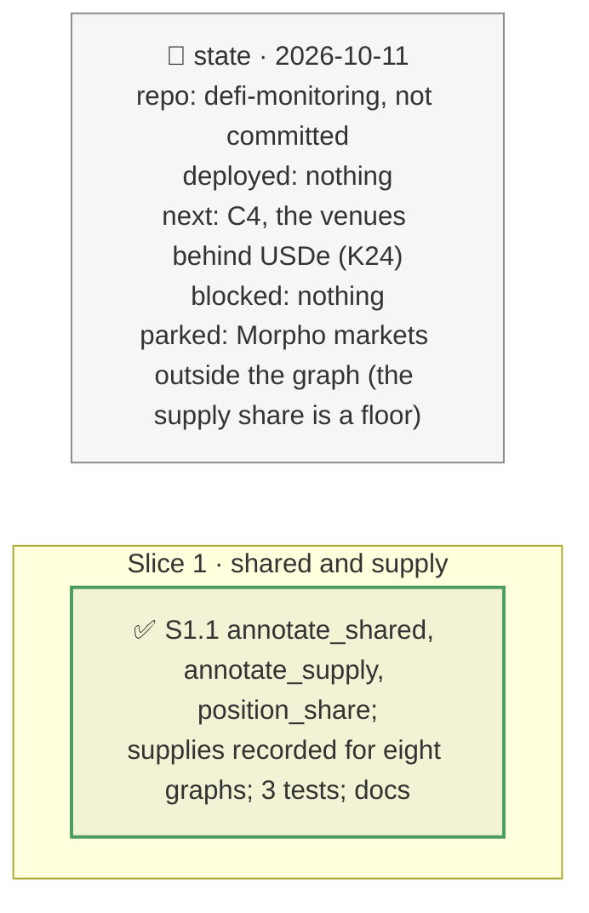

# Shared feeds and supply concentration, plan

> **Status**: approved: the person, 2026-10-11, "Implement firstly the two quick wins" (GAP K23 and K25, `NEXT_STEP.md` C2+ and C3+). No interview: the decisions below are the agent's defaults.
> **Delivers**: every oracle and feed of a graph with the markets that read it, a shared one flagged (a fault in it reaches all of them at once), in `graph`, vault incidents' hits and the PT report; every collateral with what is posted in Morpho and its share of the token's supply; the PT position's share of its market and the market's PT against its Pendle pool's reserves.
> **Hard rule**: offline from recordings (`totalSupply()` and `decimals()` at each recorded graph's block, through the archive route); `web/` untouched; the agent never commits.
> **Read against**: `docs/hackaton_instruction/GOAL.md` (the brief's scope: feed quality, concentration); `docs/analysis/GAP.md` K23, K25; plans `2026-10-11-feed-quality`, `2026-10-11-depth`, `2026-10-11-pendle-pool`.
> **Left out**: §4 Flows and §5 State.

## The tracker

mandate: mode classic · no git, the person commits · inline · tests at the slice end · verify off

# Design

## 1. Why, and why not

The brief's scope names feed quality and concentration. Freshness and protocol TVL shares were measured; a feed shared by several markets and a token concentrated in Morpho were not. **Non-goals**: Morpho markets the graph did not find (the share counts held and sibling markets, a floor); other lending venues.

## 8. Decisions

| id | Kind | Decision | Status | Source | Slice |
|---|---|---|---|---|---|
| D215 | contract | `graph.annotate_shared`, pure: each oracle a Blue market of the graph is priced by, and each feed such an oracle reads, carries the markets that read it (held and sibling); more than one is `shared`. Shown in `graph`, on vault incidents' hit feeds, and for the PT position's oracle | agreed, agent's default | D155–D157 | S1 |
| D216 | contract | `graph.annotate_supply`: each collateral of the graph's markets carries the amount its borrowers post in them and that amount's share of `totalSupply()` at the graph's block (one batch, skipped when unreadable); counted over the graph's markets, so a floor | agreed, agent's default | D81 | S1 |
| D217 | contract | The PT report's discovery depth gives the position's share of its market's collateral and debt, and the market's PT collateral against the PT reserves of its Pendle pool at the snapshot's block, with the largest sale the pool accepts | agreed, agent's default | D199, D209 | S1 |

# Execution

## 9. The slices

| Slice | Done when | Went on |
|---|---|---|
| S1 | the recorded graphs and the demo replay offline with both; 349 tests pass | mGLOeuro 88.8 % of its supply in one Morpho market, AUTO 99.8 %, oTFYe 100 %, kBTC 92.8 %, PT-trUSD 79 %, PT-sUSDE 34.8 %; on Belem, EUR/USD is read by 5 markets, 3 of them the vault's; the demo position is half its market, whose PT is 8.2× its pool's |

## Interview log

No interview: the person asked for the two quick wins.
