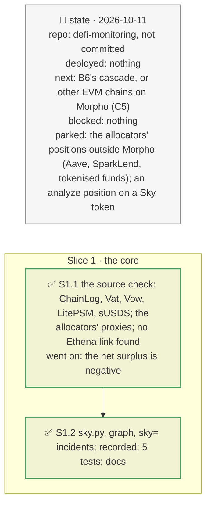

# Sky's backing look-through, plan

> **Status**: approved: the person, 2026-10-11, "Go" (the Sky look-through: GAP K19's "sUSDS's PSM and USDC", and K6 if a cross-issuer link shows). No interview: the decisions below are the agent's defaults.
> **Delivers**: behind USDS, DAI and sUSDS, where Sky's debt sits, read on-chain through Sky's ChainLog (the peg module and the USDC it holds, each allocator, crypto, RWA and staked-SKY vaults), the surplus against the system's bad debt, the debt auctions' capacity, the savings rate; in `graph`; a Sky incident `sky=<source>:<loss>` through the vault and book paths, absorbed in Sky's order (net surplus, debt auctions minting SKY, then USDS holders).
> **Hard rule**: keyless and on-chain (SKY's price from DefiLlama), recorded under `fixtures/replay/sky/` at one block; `web/` untouched; the agent never commits.
> **Read against**: `docs/hackaton_instruction/GOAL.md` (discovery 30 %, impact 30 %); `docs/analysis/GAP.md` K19, K6; `docs/external/sky/` (`dss`, `dss-lite-psm`, `usds`, the developer docs: `protocol/core/vat.md`, `vow.md`, `guides/psm/litepsm.md`; the executive votes for the allocators' proxies); plan `2026-10-11-venues` (the same shape for Ethena).
> **Left out**: §4 Flows and §5 State.

## The tracker

mandate: mode classic · no git, the person commits · inline · tests at the slice end · verify off

# Design

## 1. Why, and why not

The recorded books lend against sUSDS and USDS (the Spark USDT vault of the brief's book, PT-sUSDS siblings, cbBTC/USDS on Belem's graph), and the tool stopped at a registry entry typed by hand. Sky's backing is on-chain, so it can be read at any block and checked. **Non-goals**: the allocators' positions outside Morpho (Aave, SparkLend, tokenised funds), which their proxies hold in many forms; an `analyze` position on a Sky token (the demo's is on sUSDe).

## 8. Decisions

| id | Kind | Decision | Status | Source | Slice |
|---|---|---|---|---|---|
| D223 | contract | `sky.load` at one block: the ChainLog (`0xdA0A…740F`) gives the Vat, the Vow, the IlkRegistry, USDS, sUSDS, DAI, the LitePSM and SKY; each collateral type's debt is Art × rate; the LitePSM's USDC is its `gem` balance at its `pocket`; the surplus is `Vat.dai(vow)`, the system's bad debt `Vat.sin(vow)`; sUSDS's `ssr` gives the savings rate; SKY's market value is its supply × DefiLlama's price. Recorded under `fixtures/replay/sky/` with its block | agreed, agent's default; found: the docs give the Vow's accounting (`vow.md`) | `docs/external/sky` | S1 |
| D224 | contract | Collateral types grouped by name into sources (`sky.sources`): the peg module, each allocator (`ALLOCATOR-<NAME>-A`), RWA vaults, staked-SKY vaults, the rest crypto vaults; in `graph`, one External node per source behind USDS and DAI, the surplus and auction capacity on USDS, the savings rate on sUSDS | agreed, agent's default | D221 | S1 |
| D225 | contract | `sky_loss`, pure: a source losing a share of what backs it (the peg module: of its USDC); absorbed in Sky's order: the net surplus (none when negative), debt auctions minting SKY up to `sky.debt_auction_share` (25 %) of SKY's market value, then USDS, DAI and sUSDS marked down over the USDS and DAI in circulation | agreed, agent's default; the auction share is a stated judgement | `vow.md` | S1 |
| D226 | contract | `sky=<source>:<loss>` in `--vault`, `--book` and `POST /api/incident`, as `token=` markdowns of USDS, sUSDS and DAI; refused for `analyze`'s position (not on a Sky token) and when nothing reaches USDS holders | agreed, agent's default | D220 | S1 |

# Execution

## 9. The slices

| Slice | Done when | Went on |
|---|---|---|
| S1 | the core replays offline; the Spark vault and the books run a `sky=` incident; 373 tests pass | at block 26,167,107: 11.69B of debt, the peg module 44.7 % (4.42B USDC), Spark 30.9 %, Bloom 14.6 %, Obex 3.5 %, Grove 1.0 %, crypto 3.3 %, staked SKY 1.4 %, RWA 0.7 %; surplus 665.7M against 717.4M of bad debt, net −51.7M; SKY worth 1.80B, auctions about 450M; sUSDS 4.91B at 3.80 %. Spark's allocation −20 %: 722M, 450M from auctions, USDS and sUSDS −2.36 %: the Spark USDT vault's sUSDS/USDT market has 1.7M liquidatable, no bad debt. The cross-issuer check (K6): Spark's and Grove's proxies hold no USDe or sUSDe, and the Morpho vaults they supply lend on wstETH, WBTC, cbBTC and sUSDS: no Ethena link through these paths today; Spark supplies the Spark USDT vault of the brief's book |

## Interview log

No interview: the person asked to go.
