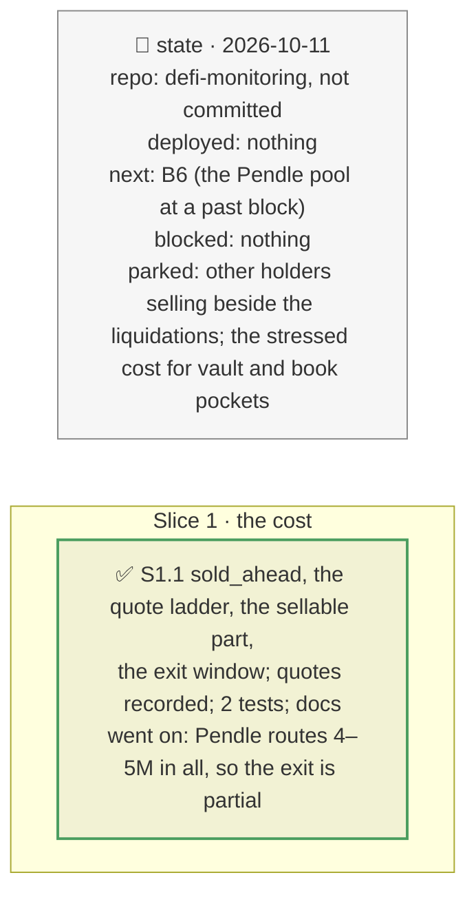

# The stressed exit cost, plan

> **Status**: approved: the person, 2026-10-11, "Go for it" (`NEXT_STEP.md` B3). No interview: the decisions below are the agent's defaults.
> **Delivers**: `analyze --shock` prices the exit after the incident's own liquidations: what the market's other borrowers are liquidated for at the incident's oracle fall, sold first, then the position's sale on top of theirs, from real Pendle quotes; how much of the position can still leave when Pendle stops routing. The verdict counts that cost when the incident lands within the exit window, and shows it next to today's quote otherwise.
> **Hard rule**: offline from the analyze snapshot (the quotes recorded in it) and the borrower's recorded graph; no new provider; `web/` untouched; the agent never commits.
> **Read against**: `docs/hackaton_instruction/GOAL.md` (decision 25 %, "is the number defensible"); `docs/analysis/GAP.md` K12; plans `2026-10-10-incident-mode`, `2026-10-11-depth`, `2026-10-11-pool-move`.
> **Left out**: §4 Flows and §5 State.

## The tracker

mandate: mode classic · no git, the person commits · inline · tests at the slice end · verify off

# Design

## 1. Why, and why not

Every incident verdict compares the loss of staying with the cost of leaving, and that cost was today's quote at today's depth. In the incident, liquidators sell the same collateral first. **Non-goals**: other holders' panic sales (unknown, not counted); the stressed cost for vault pockets (their exit is a withdrawal, priced by the exit queue).

## 8. Decisions

| id | Kind | Decision | Status | Source | Slice |
|---|---|---|---|---|---|
| D206 | contract | Sold ahead: the debt the incident makes liquidatable among the market's other borrowers (the market's liquidation curve in the borrower's recorded graph, its last point at or below the incident's oracle fall, the position's own debt left out) times the LIF. The exit after them: Pendle quotes (aggregator into the loan token, as the exit quote) at a small size, the position, the amount ahead and the amount ahead plus 10 %, 25 %, 50 %, 75 % and 100 % of the position; today's cost plus the extra slippage of the position's slice. When Pendle stops routing, the part it still routes and its slippage; no full-exit cost. The verdict counts the stressed cost when the incident reaches the oracle within `incident.exit_window_s` (1 h: liquidation bots act in the update's block); otherwise it keeps today's quote and shows the stressed figure | agreed, agent's default | D90, D204 | S1 |

# Execution

## 9. The slices

| Slice | Done when | Went on |
|---|---|---|
| S1 | the demo runs offline with the stressed exit | Pendle routes the full 3.96M exit today (about 2.5 % slippage) but refuses between 4M and 5M in all: after a 10 % oracle fall liquidates 3.64M of the other borrowers, only 393k (10 % of the position) can still be sold, at 30.7 % slippage on that slice. The quotes were taken 2026-10-11, a day after the snapshot |

## Interview log

No interview: the person asked for B3.
