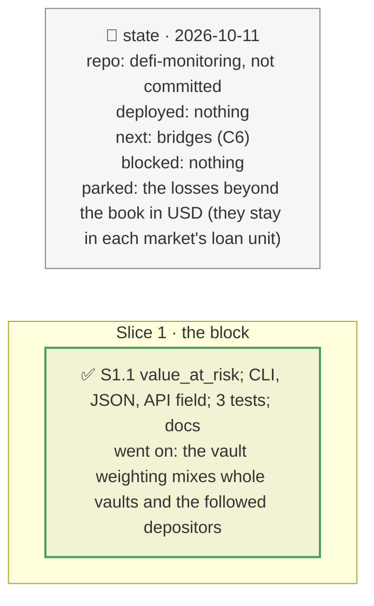

# Value at risk after an incident, plan

> **Status**: approved: the person, 2026-10-11, "Yes go for value at risk. If relevant add an endpoint too for the front-end". No interview: the decisions below are the agent's defaults.
> **Delivers**: one VALUE AT RISK block for every vault and book incident, gathered from figures already computed: the money in the hit markets, the expected loss if it happens and its worst pocket, the 95 % and 99 % worst cases given the incident (with `--conditional`), the certain cost of leaving the hit pockets against what it saves, and the losses beyond the book (the lenders of the other markets the incident reaches); in the CLI, `book-incident.json` and `POST /api/incident` (`book.value_at_risk`).
> **Hard rule**: no new computation of risk, only a gathering; `web/` untouched (`openapi.json` regenerated); the agent never commits.
> **Read against**: `docs/hackaton_instruction/GOAL.md` (decision 25 %); plans `2026-10-11-vault-book`, `2026-10-11-conditional`, `2026-10-11-one-number` (D141, sibling losses).
> **Left out**: §4 Flows and §5 State.

## The tracker

mandate: mode classic · no git, the person commits · inline · tests at the slice end · verify off

# Design

## 1. Why, and why not

Every figure existed (the exposure column, the headline, the conditional draw, the sibling note), spread over the output; a risk manager asks one question first: how much is at risk. **Non-goals**: a new risk measure; a separate endpoint (the incident's response carries the block, and a second route would run the same incident again).

## 8. Decisions

| id | Kind | Decision | Status | Source | Slice |
|---|---|---|---|---|---|
| D227 | contract | `vault_book.value_at_risk`, pure, on every book result (a vault alone is a book of one): exposure, expected loss and its share, the pockets hit and the worst, the conditional draw's 95 % and 99 % when it ran, the cost of leaving the hit pockets and what it saves, and the sibling markets' lenders' losses, each market counted once and left out when the book holds it, summed by loan unit. In the `vault` weighting the loss counts each vault whole while the draw, the cost and the saving are the followed depositors': each line says so (`loss_is_whole_vaults`). Served as `book.value_at_risk` by `POST /api/incident`, no new route | agreed, agent's default; found: the vault weighting's perspectives differ; changed with plan `2026-10-11-after`: the block names its incident (`incident`) and says "loss if it happens, at that size", not an expected loss | D122, D141, D165 | S1 |

# Execution

## 9. The slices

| Slice | Done when | Went on |
|---|---|---|
| S1 | the block prints for vaults and books, and serves over the API; 376 tests pass | the mixed book under a Binance loss: 1M at risk in 1 of 10 pockets, 407k expected, 95 % 681k, 99 % 815k, leaving costs 110k against 407k saved; a PT-trUSD markdown on RockawayX USDC Yield: nothing in the vault, 416k USDC lost by a sibling market's lenders |

## Interview log

No interview: the person asked for it.
