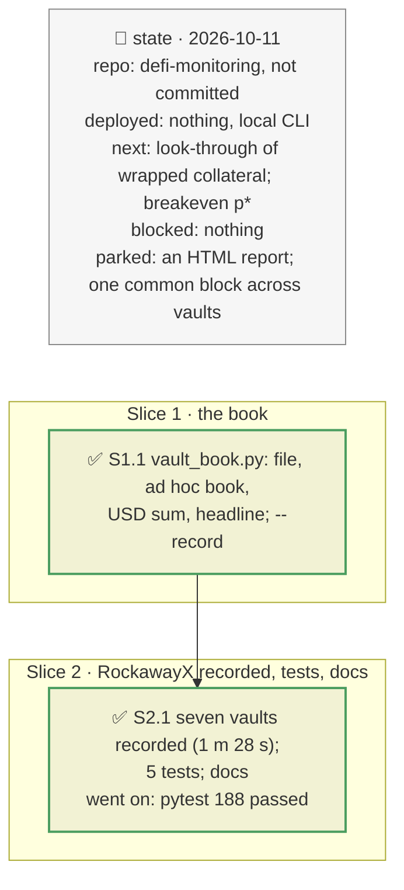

# A book of vaults under one incident, plan

> **Status**: approved: the person, 2026-10-11, "Yes go for it but write something adaptable. We should be able to define or specify other vaults" (step 3 after `docs/analysis/ROCK-VAULT.md`). No interview: the decisions below are the agent's defaults.
> **Delivers**: `analyze --book <file> --shock token=<collateral>:<fall>` (or several `--vault`) applies one issuer incident to every vault of a user-defined book, and gives each vault's loss, the book's loss in USD, where the collateral sits, and one headline. `--record` captures any vault for offline runs. Proof: RockawayX's seven Morpho Vault V2 vaults on Ethereum, recorded on 2026-10-11, under a 30 % cut of each issuer token.
> **Hard rule**: no new provider (the RPC, the Morpho API, DefiLlama prices already used); a book is data, never code; the agent never commits.
> **Read against**: `defi-monitoring` after plan `2026-10-11-vault-incident`; `docs/analysis/ROCK-VAULT.md` §2 (the vaults); the brief's book of pockets (`docs/hackaton_instruction/GOAL.md`).
> **Left out**: §4 Flows and §5 State: a one-shot computation per vault.

## The tracker

mandate: mode classic · no git, the person commits · inline · tests at the slice end · verify off

# Design

## 1. Why, and why not

The brief asks what an incident does "to your book". The sponsor's curator, RockawayX, runs several Morpho vaults that lend against the same young issuers, so one issuer's markdown reaches several vaults at once (`ROCK-VAULT.md` §1). A book must be definable by whoever runs the tool, for their own vaults.

**Non-goals**: borrow and PT pockets (now `NEXT_STEP.md` A6); vaults on other chains or venues; a probability per incident (the breakeven p\* comes next).

## 3. Modules, after

- **`vault_book.py`**, new. Pure: `load`, `parse`, `from_addresses`, `line`, `aggregate`, `BookIncident.text`. I/O: `write`.
- **`vault_incident.py`**: each hit market carries the vault's exposure; the incident carries the vault asset's USD price; `run(..., profile_all=True)` reads every market's oracle.
- **`cli.py`**: `--vault` repeatable, `--book`, `--record`; `_vault_source` picks the incident recording, the watch recording, or the live chain.
- **`examples/rockawayx-ethereum.json`**: the book of the demo, and the template for any other.
- **`fixtures/replay/incident-<vault>/`**: one recording per vault, with `meta.json` (`vault`, `block`).

## 8. Decisions

| id | Kind | Decision | Status | Source | Slice |
|---|---|---|---|---|---|
| D120 | contract | A book is a JSON file: `name`, `weighting` (`vault` or `depositor`, default `vault`), and `vaults`, each an address or `{address, label, depositor}`. Several `--vault` flags make an ad hoc book, in the `depositor` weighting when `--user` is given. Invalid or repeated addresses are refused | agreed, the person asked for books anyone can define | — | S1 |
| D121 | module | `--record` reads each vault live at the head and saves every response, including every market's oracle profile, under `fixtures/replay/incident-<vault>/`; offline runs read that recording first, then the watch recording at its state block; `--live` reads the chain without saving | agreed, agent's default | — | S1 |
| D122 | contract | Each vault enters the book in USD, at the DefiLlama price of its asset (EURCV differs from USDC); without a price, 1 USD per unit, and the book says so. `vault` weighting: the vault's total and loss; `depositor`: the depositor's position and its loss if it stays | agreed, agent's default | — | S1 |
| D123 | contract | The headline: the incident, the book's loss and its share, the number of vaults hit, the largest loss, and which vault to act on first (the largest loss among the vaults where leaving first lowers the loss), or that none would | revised by D144 (plan `2026-10-11-breakeven`): the vault to act on first is the one with the lowest breakeven probability | the brief's "one number" | S1 |
| D124 | contract | A token matches a market by the collateral's address or symbol, directly; a wrapper of the token (a PT, an ERC-4626 share) is not matched yet | agreed, found in S2: trUSD and wYLDS match no market, although PT-trUSD and etrUSD markets depend on them | — | S2 |
| D125 | module | Each vault is read at its own block; recorded together, the RockawayX vaults are minutes apart | agreed, agent's default | — | S2 |

# Execution

## 9. The slices

| Slice | Done when | Went on |
|---|---|---|
| S1 | a two-vault book adds up in both weightings; the headline names a vault to act on | — |
| S2 | the seven RockawayX vaults recorded and run offline under a cut of each issuer token; 188 tests pass | D124 found: wrapped collateral is not matched |

## Interview log

No interview: the person approved the step and asked for books definable by the user.
