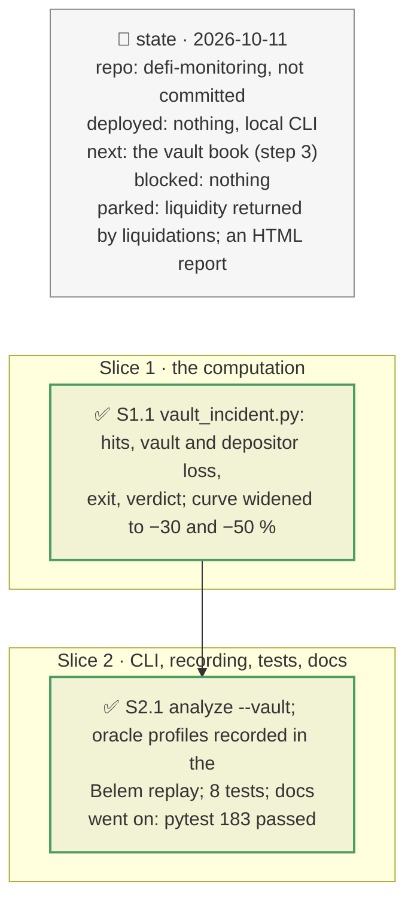

# Incident mode for a vault depositor, plan

> **Status**: approved: the person, 2026-10-11, "Yes implement this" (step 2 of the plan after `docs/analysis/ROCK-VAULT.md`). No interview: the decisions below are the agent's defaults.
> **Delivers**: `analyze --vault <address> --shock token=<collateral>:<fall> [--user <depositor>]` gives, for a known fall of a collateral's oracle price (an issuer NAV markdown), each hit market's liquidatable debt and bad debt from all its borrowers, the vault's loss, the depositor's loss if it stays and if it leaves first, what can leave now, how fast the incident lands, and a verdict. Proof: the Belem RWA EURCV vault offline, at −10, −30 and −50 % on mGLOeuro.
> **Hard rule**: no new provider; the existing modes keep their behaviour; the agent never commits.
> **Read against**: `defi-monitoring` after plan `2026-10-10-incident-mode`; `docs/analysis/ROCK-VAULT.md` §5.1 (the Belem vault recorded and checked); `market_risk.value` (D45–D50); `exit_queue.py` (D62–D67).
> **Left out**: §4 Flows and §5 State: a one-shot computation on a recorded or live block.

## The tracker

mandate: mode classic · no git, the person commits · inline · tests at the slice end · verify off

# Design

## 1. Why, and why not

The brief's sponsor holds vault deposits, and its own vault lends 86 % of its assets against a token whose oracle is the issuer's NAV (`ROCK-VAULT.md` §5.1). The incident that threatens it is a NAV markdown, not a market depeg, and incident mode (plan `2026-10-10-incident-mode`) only covered a borrower's position.

**Non-goals**: the liquidity that liquidations return to the market (it depends on a liquidator buying the issuer's token); several vaults at once (step 3); an HTML report (JSON and terminal only).

## 3. Modules, after

- **`vault_incident.py`**, new. Pure: `parse_token_shocks`, `nav_timing`, `market_hit`, `decide`, `VaultIncident.lines`. I/O: `run` (vault, state, every borrower of its markets, oracle profiles), `write`.
- **`cli.py`**: `analyze --vault`, offline from `fixtures/replay/<vault>/` (the watch recording, at its state block), `--live` at the head.
- **`market_risk.py`**: `CURVE_DROPS` gains −30 % and −50 % (D98).
- **`fixtures/replay/0xd6d4…48ec/`**: the oracle-profile reads of the vault's six oracles added, with one live run.

## 8. Decisions

| id | Kind | Decision | Status | Source | Slice |
|---|---|---|---|---|---|
| D98 | contract | The liquidation curve steps become 2, 5, 10, 20, 30 and 50 % (revises D50): an issuer markdown creates bad debt only past about 25 % on a 77 % LLTV market, which the 20 % ceiling hid | agreed, found on the Belem vault | `ROCK-VAULT.md` §5.1 | S1 |
| D99 | contract | A vault incident is `token=<collateral address or symbol>:<fall>`: the collateral's oracle price falls by that fraction. Each market of the vault holding it is valued at the shocked price with all its borrowers (`market_risk.value`); markets where the vault holds less than one token are skipped (D47) | agreed, agent's default | — | S1 |
| D100 | contract | Timing from the market oracle's class: constant-price (an issuer's rate or NAV) lands at once on publication, with no market move before it; price-tracking follows the feed; a meta-oracle as in D91 | agreed, agent's default | `oracle_class.py` | S1 |
| D101 | contract | The depositor's loss if it stays is its share of the vault × the vault's loss; if it leaves first, the exit queue's loss on what cannot leave (`exit_queue`). EXIT only when leaving first cuts the loss by at least `incident.exit_min_gain` (5 %); otherwise STAY, with the reason | agreed, found in S1: a 99.46 % depositor saved 0.2 %, and EXIT would have been misleading | registry `incident.exit_min_gain` | S1 |
| D102 | module | Offline, `analyze --vault` reads the vault's watch recording at its state block; `--live` reads the chain at the head, without caching | agreed, agent's default | — | S2 |
| D103 | contract | Output: the terminal block and `out/vault-incident-<vault>.json`; notes say that bad debt is realised only at liquidation (a run incentive until then), that issuer-priced collateral needs a buyer of the issuer's token to be liquidated, and when the hit market is the vault's liquidity market | agreed, agent's default | — | S2 |

# Execution

## 9. The slices

| Slice | Done when | Went on |
|---|---|---|
| S1 | the Belem numbers match a hand computation (bad debt from a cut of about 25 %; 1.23M at −50 %) | EXIT was printed for a 0.2 % gain: D101 threshold added |
| S2 | the CLI runs offline on Belem; 183 tests pass | the oracle profiles were missing from the watch recording; recorded once with `--live` into the same folder |

## Interview log

No interview: the person approved step 2 after the Belem vault was recorded and checked.
