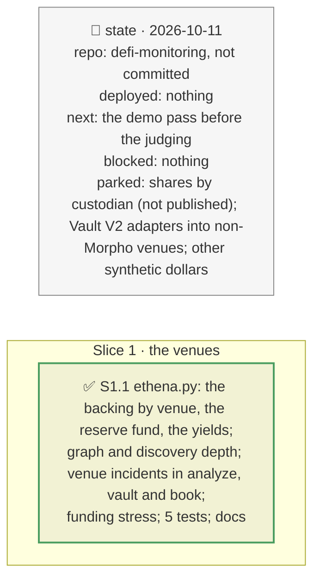

# The venues behind USDe, plan

> **Status**: approved: the person, 2026-10-11, "Go ahead" (`NEXT_STEP.md` C4, GAP K24). No interview: the decisions below are the agent's defaults.
> **Delivers**: behind USDe (and so behind sUSDe and the brief's PT-sUSDe position), where Ethena's backing sits: the exchanges holding margin for its hedges with their shares, what is not on an exchange, the off-exchange settlement providers, the reserve fund and the yields, in `graph` and the PT report's discovery depth; a venue incident `venue=<exchange>:<loss>` in `analyze --shock`, `--vault`, `--book` and `POST /api/incident`; a funding-stress line (how long the reserve fund pays negative funding).
> **Hard rule**: keyless (Ethena's transparency API), recorded under `fixtures/replay/ethena/`, offline by default; `web/` untouched; the agent never commits.
> **Read against**: `docs/hackaton_instruction/GOAL.md` (the brief's scope: "vaults routing capital into a perp venue"; discovery 30 %, impact 30 %); `docs/analysis/GAP.md` K24; `docs/external/ethena/` (custody, off-exchange settlement, liquid stablecoins); plans `2026-10-11-pharos`, `2026-10-11-depth`.
> **Left out**: §4 Flows and §5 State.

## The tracker

mandate: mode classic · no git, the person commits · inline · tests at the slice end · verify off

# Design

## 1. Why, and why not

The brief's worked position is a PT on sUSDe, a claim on USDe, itself a delta-neutral position whose collateral sits with custodians and whose hedges sit on exchanges. The tool stopped at "sUSDe backed by USDe 100 %" (Pharos). **Non-goals**: a model of an exchange (margin engine, auto-deleveraging); shares by custodian, which the dashboard does not publish; Vault V2 adapters into non-Morpho venues (none among the recorded vaults); other synthetic dollars.

## 8. Decisions

| id | Kind | Decision | Status | Source | Slice |
|---|---|---|---|---|---|
| D218 | contract | `ethena.load`: `app.ethena.fi/api/positions/current/collateral` (the backing by asset and by venue: each exchange, and "Unallocated" for what is not on one), `/solvency/reserve-fund` (its last point kept) and `/yields/protocol-and-staking-yield` (30-day averages); keyless; recorded under `fixtures/replay/ethena/`; optional: no positions, no venue layer | agreed, agent's default; found: the documented API serves minting only, the dashboard's backend answers keyless | `docs/external/ethena` | S1 |
| D219 | contract | `ethena.venue_loss`, pure: losing a share of what sits at a venue; the reserve fund absorbs it first; the rest, over the total backing, marks USDe down, and sUSDe (a claim on USDe) by the same fraction. The hedges held there are lost too: said, not modelled | agreed, agent's default | — | S1 |
| D220 | contract | `venue=<venue>:<loss>` in every incident path: for `analyze` an `issuer_depeg` of that markdown with nothing recovered (a loss of backing is permanent; the oracle's class decides when it is seen); for a vault or a book, `token=` markdowns of USDe and sUSDe, the book's borrow pocket priced like `analyze`. A loss within the reserve fund leaves nothing to run | agreed, agent's default | D89–D92, D177 | S1 |
| D221 | contract | In `graph` (`annotate_ethena`) and the PT report: one External node per venue behind USDe with its share, one for the off-exchange settlement providers (Copper, Ceffu), the reserve fund on USDe; and a funding-stress line: at `ethena.funding_stress` (−10 %/yr) on the hedged notional (taken as the margin on exchanges), what the reserve fund pays a day and how many days it lasts | agreed, agent's default | D133, D199 | S1 |

# Execution

## 9. The slices

| Slice | Done when | Went on |
|---|---|---|
| S1 | the demo, the mixed book and the graph replay offline with the venues; 354 tests pass | on 2026-10-11: 4.77B of backing, 79.5 % not on an exchange, Binance 13.4 %, OKX 4.2 %, Bybit 2.3 %, Deribit 0.4 %, CDE 0.2 %; reserve fund 62.1M. Half the margin at Binance lost: 319M, 62M absorbed, USDe and sUSDe −5.39 %: the PT loop is liquidated once the meta-oracle switches (−404k, 78 % of equity), EXIT with 16 h to act; in the mixed book its pocket loses 407k. Funding at −10 %/yr: 267k a day, 232 days of reserve |

## Interview log

No interview: the person asked to go ahead.
