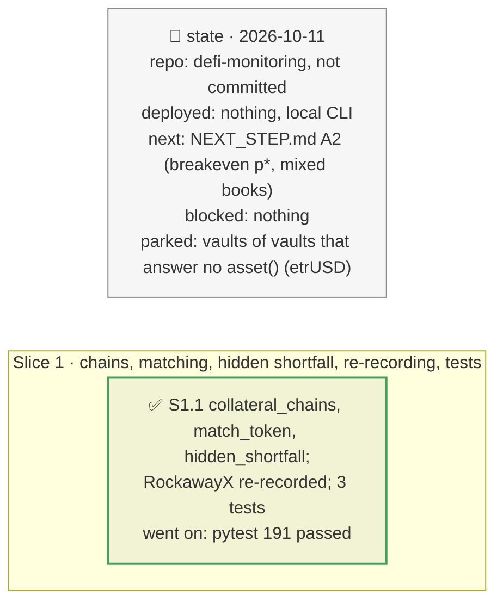

# Wrapped collateral in vault incidents, plan

> **Status**: approved: the person, 2026-10-11, "Yes implement it" (step A1 of `docs/analysis/NEXT_STEP.md`, gap K26). No interview: the decisions below are the agent's defaults.
> **Delivers**: a vault incident on a token (`--shock token=<token>:<fall>`) also reaches the markets whose collateral wraps that token (a PT, an ERC-4626 share, chains of them), says through which path, and counts the loss according to the market oracle's class: followed like a direct hit when the oracle tracks a market, a hidden shortfall with no liquidation otherwise. Proof: `token=trUSD:0.30` on the recorded RockawayX book reaches two vaults (1.61M USD), where it reached none.
> **Hard rule**: no new provider (Pendle API and RPC already used); the agent never commits.
> **Read against**: plans `2026-10-11-vault-incident` and `2026-10-11-vault-book`; `siblings.underlyings` (D77); `GAP.md` K26; `ROCK-VAULT.md` §5.2.

## The tracker

mandate: mode classic · no git, the person commits · inline · tests at the slice end · verify off

# Design

## 8. Decisions

| id | Kind | Decision | Status | Source | Slice |
|---|---|---|---|---|---|
| D110 | contract | Each market's collateral is resolved to what it wraps, up to four levels: a PT's Pendle underlying, an ERC-4626 share's `asset()` (`siblings.underlyings`). A shocked token, by address or symbol, hits a market whose collateral is it or wraps it; the hit carries the path (`via`). The registry's stablecoins end a chain: they are the loan assets, and a USDC markdown through a wrapper would mean nothing here | agreed, agent's default; the stablecoin rule found in S1 (`token=USDC` matched three vaults through wYLDS) | `siblings.family` | S1 |
| D111 | contract | A market reached through a wrapper is "seen" only if its oracle is price-tracking: then it is valued at the shocked price, as a direct hit. Otherwise the oracle does not move, nothing is liquidated, and the loss counted is the hidden shortfall Σ max(0, debt − collateral × (1 − fall)), which lands if the markdown persists; the output says so. An issuer NAV oracle that does reprice from its underlying would be "seen"; that is not read yet | agreed, agent's default | — | S1 |

## 9. Slices

| Slice | Done when | Went on |
|---|---|---|
| S1 | trUSD reaches PT-trUSD, PT-strUSD and strUSD markets on the recorded book; 191 tests pass | the seven vaults were re-recorded (`--record`) so the chains are offline; etrUSD stays opaque (no `asset()`) |
