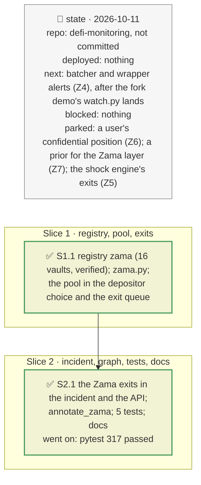

# Zama confidential vaults, plan

> **Status**: approved: the person, 2026-10-11, "Go and implement it" (steps Z1, Z2, Z3 of `docs/analysis/ZAMA-VAULT.md`; Z5 assessed and left out, see §1). No interview: the decisions below are the agent's defaults.
> **Delivers**: every mainnet vault of Zama's Confidential Vault protocol is known (16, checked on-chain); a cShare is treated as a pool of confidential depositors, not as the vault's depositor nor as a fast holder ahead in a run; a vault incident on a Zama vault states the confidential share and a confidential depositor's two exits against how the incident lands; `graph` draws the hidden layer (cShare, batchers, Zama's decryption, the wrapper registry, the deposit gate). Proof: RockawayX Confidential RWA, whose "depositor holding 99 % of the vault" was the cShare: its default depositor is now its largest public holder (0.89 %), for whom leaving first pays above a 6.6 % chance over 30 days; a confidential depositor's next batch is 12.4 h away and does not beat a NAV markdown, the instant exit does and reveals the amount.
> **Hard rule**: keyless reads only (the recordings' new reads through the archive RPC route, keyless in the files); `web/` untouched (the graph uses its existing node kinds); no user amount stored; the agent never commits.
> **Read against**: `docs/analysis/ZAMA-VAULT.md`; `docs/external/docs.zama.org-protocol-docs/confidential-vault/` (addresses, batcher interface, concepts); plan `2026-10-10-exit-queue` (D64, D66).
> **Left out**: §4 Flows and §5 State.

## The tracker

mandate: mode classic · no git, the person commits · inline · tests at the slice end · verify off

# Design

## 1. Why, and why not

The demo's Confidential RWA vault read "nothing to save by leaving first: the depositor is 99 % of the vault". That holder was the Zama cShare, the pool of every confidential depositor: the verdict and the exit queue described a holder that does not exist. The Zama layer is also the brief's "hidden dependencies": a vault page shows a Morpho vault and nothing of the decryption every confidential exit needs.

**Non-goals**: Z4, batcher and wrapper alerts (they touch `watch.py` and `rules.py`, which the fork demo is editing, and need a recording across one daily batch); Z5, `Zama Protocol:halted` in the shock engine (the engine models losses through markets, not withdrawals: a halt freezes exits without a loss, which its rules cannot express; the incident states it instead); Z6, a user's confidential position (the amount only the user can decrypt); Z7, a prior (with B5).

## 3. Modules, after

- **`zama.py`**, new: `entry`, `is_pool`, `exits` (pure); `read` (the confidential share, the batchers' next dispatch, paused, the gate).
- **`vault.py`**: `largest_depositor(..., exclude)`. **`exit_queue.py`**: a pool is never a fast holder.
- **`vault_incident.py`**: `VaultIncident.zama`, read for a Zama vault. **`graph.py`**: `annotate_zama`, called by `graph`. **`api/schemas.py`**: `zama`.
- **`registry.json`**: `zama` (router, wrapper registry, 16 vaults, `instant_exit_minutes`).
- **`fixtures/replay/incident-0xc207…`, `incident-0xe018…`**: the Zama reads and the public depositor's position at the recorded block.

## 8. Decisions

| id | Kind | Decision | Status | Source | Slice |
|---|---|---|---|---|---|
| D171 | contract | The Zama vaults are registry data: every mainnet vault of the Zama address list, keyed by vault address, each with its batchers, cShare, cAsset, underlying, gate and deploy block; checked on-chain (the batchers' `vault()`, `fromToken()`, `toToken()`: 16 of 16) | agreed, agent's default | Zama `reference/addresses.md` | S1 |
| D172 | contract | A cShare is a pool of confidential depositors: never the default depositor (`largest_depositor` skips it) and never a fast holder ahead in the exit queue | agreed, found: Confidential RWA's 99.1 % holder | `ZAMA-VAULT.md` §2.3 | S1 |
| D173 | contract | For a Zama vault the incident reads, at its block: the cShare's share of the vault, the redeem batcher's current batch and when it can be dispatched (`batchCreatedAt + batchMinBatchAge`), the deposit batcher's, `paused`, the deposit gate | agreed, agent's default | Zama `reference/batcher-interface.md` | S1 |
| D174 | contract | A confidential depositor's two exits are stated next to the verdict: the batch (its dispatch time, settled at the share price then, after a decryption; "does not beat" an incident that lands at once, i.e. a constant-price oracle with a loss) and the instant exit (about `zama.instant_exit_minutes`, first in line, the amount public); both need Zama's decryption | agreed, agent's default | `ZAMA-VAULT.md` §2.2 | S2 |
| D175 | contract | `graph` draws, for each Zama vault: the cShare (`wraps` the vault), the cAsset, the two batchers (`redeems from`, `deposits into`, `takes`), Zama Protocol (`decrypted by`), the wrapper registry (`can be paused by`), the deposit gate (`accepts deposits only from`); existing node kinds only, so the web app renders it unchanged. Not added to the incident's engine graph | agreed, agent's default | — | S2 |
| D176 | module | The recordings' new reads at a past block go through the archive RPC route (keys.ini), cached under the public URL | agreed, as D161 | — | S2 |

# Execution

## 9. The slices

| Slice | Done when | Went on |
|---|---|---|
| S1 | the 16 vaults verified; Confidential RWA's 99.1 % and USDC Yield's 0.84 % read | — |
| S2 | the incident and the graph offline; 317 tests pass | the public depositor's position at the recorded block was not in the recording: read once through the archive RPC |

## Interview log

No interview: the person approved Z1, Z2, Z3 and Z5; Z5 was left out for the reason in §1.
