# A crisis on a mainnet fork

**riskdep watching the Belem RWA EURCV vault while its collateral is marked down**

Ryan Sauge · v1.0 · 2026-10-11

Talk length: about 7 minutes (13 slides, 25 to 40 seconds each)

Source: `scripts/fork/DEMO-EXPLAINED.md`, `scripts/fork/README.md`, `docs/analysis/FORK-PRESENTATION.md`, `plan/2026-10-11-fork-demo.plan.md`, `plan/2026-10-11-detect.plan.md`, the run of `scripts/fork/demo.sh --short` (112 s)

---

## 1. A crisis on a mainnet fork

The demo copies Ethereum mainnet onto a laptop, plays a crisis on a real vault through the accounts that hold those powers on mainnet, and lets riskdep watch it happen. It answers the brief's question live: what is lost, how fast, and whether to stay.

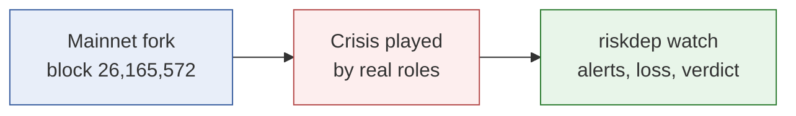

> **Speaker notes (25 s):** One command runs it: `scripts/fork/demo.sh --short`, about two minutes. A recording replays it offline.

---

## 2. Why a fork

A recorded mainnet range shows what happened, and crises are rare. A fork keeps every real balance, position, oracle and role, and lets the demo cause the crisis. Nothing reaches the real network, and each step uses a role the protocols grant: the issuer's feed admin, a timelock proposer, a liquidator.

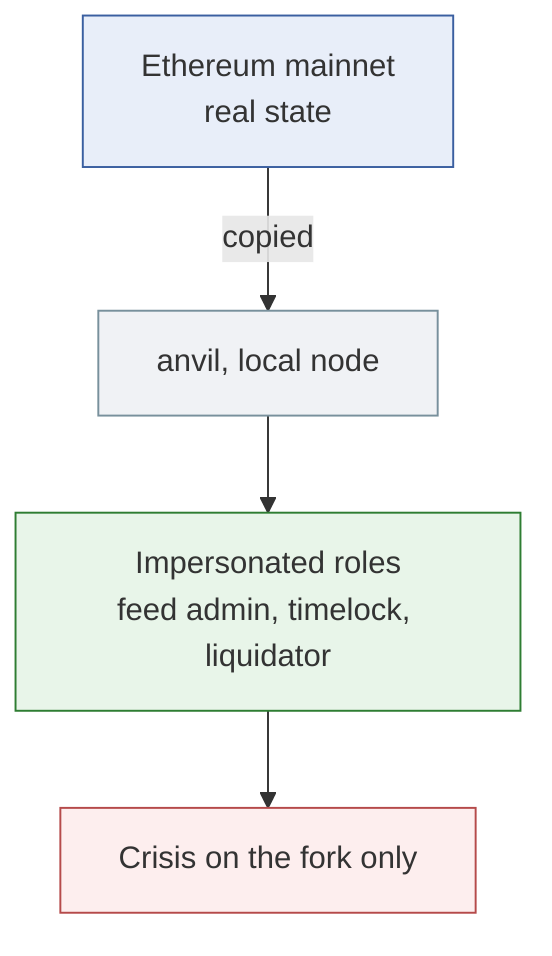

> **Speaker notes (35 s):** anvil can send a transaction from any address, so no key is needed. The fork's upstream is a keyless archive endpoint; a time jump of 48 hours is one RPC call. No exploit is involved.

---

## 3. The vault: three fragilities

Belem RWA EURCV is a Morpho Vault V2 curated by RockawayX, holding 4.71M EURCV. 86 % is lent in one market against mGLOeuro, a Midas token for a private-credit fund. One wallet writes mGLOeuro's price, and one borrower holds the whole debt.

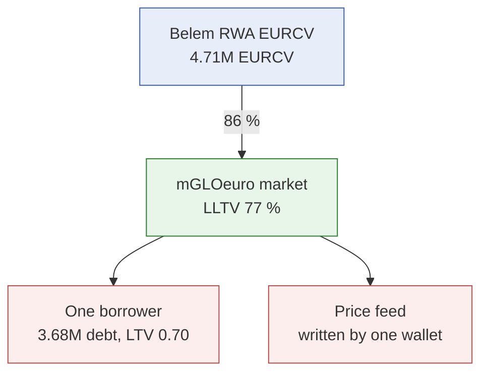

> **Speaker notes (35 s):** The feed accepts any value between 90,000 and 110,000 EUR per token; below 90,000 it needs new code, installed through a 48-hour timelock. The borrower posted 52.58 mGLOeuro, about 5.26M EUR at 100,000 each.

---

## 4. What each price means

From the borrower's position, two thresholds follow. Below 90,857 EUR the borrower can be liquidated; below 75,142 EUR even liquidating all its collateral, with the liquidator's 7.4 % bonus, no longer repays the debt, and the vault takes bad debt.

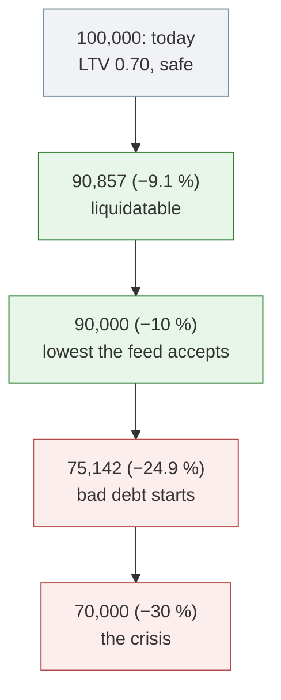

> **Speaker notes (35 s):** Liquidatable: 100,000 × 0.70 ÷ 0.77. Bad debt: debt × 1.074 ÷ collateral. The feed's floor of 90,000 sits just below the liquidation threshold: one transaction makes the borrower liquidatable, but no real loss beyond 10 % can reach the price without the upgrade.

---

## 5. The prediction, before anything happens

Before the crisis, riskdep prices two markdowns from a recording of the vault, in a second. At −10 % the borrower is liquidatable but the collateral still covers the debt: no loss. At −30 % the vault loses 251,761 EURCV, and the verdict is still STAY.

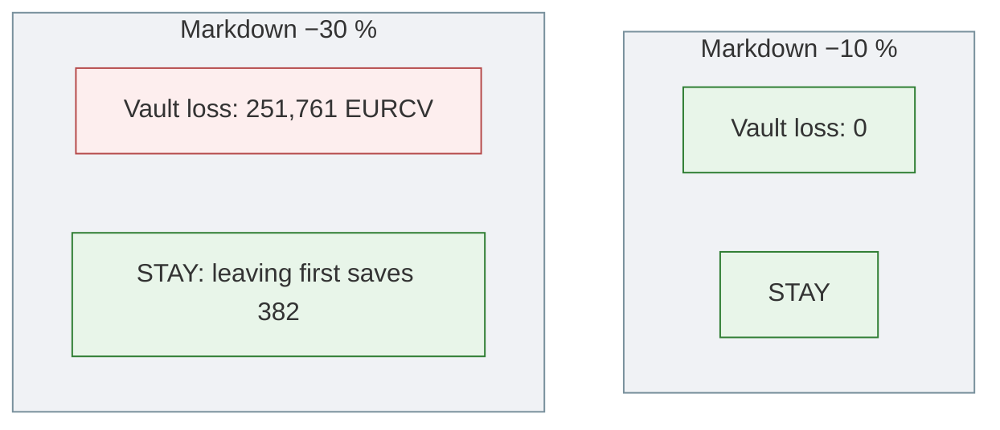

> **Speaker notes (40 s):** Why stay with a 250,000 loss? The largest depositor holds 99.5 % of the vault: leaving first only pushes the loss onto others, and there are almost none. At 91 % utilisation only about 8 % can be withdrawn at all. The prediction is saved to compare with what happens.

---

## 6. What riskdep finds at start-up

While the prediction runs, riskdep reads the vault, its markets, every borrower and who controls each contract. Three findings matter for what follows: the feed's floor, the timelock above it, and the vault's exit gates.

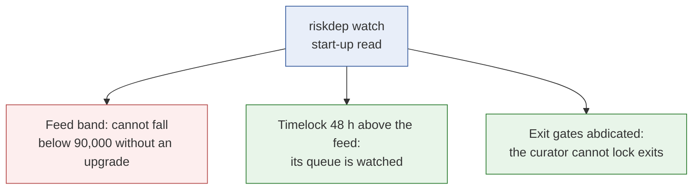

> **Speaker notes (35 s):** The feed band is the key finding: a loss larger than 10 % stays invisible to the market until new code is installed. Found from the vault address alone, two contracts away from the vault.

---

## 7. The issuer marks the NAV down 10 %

The issuer's wallet sets the price to 90,000 in one transaction, with no delay. The borrower's LTV rises to 77.7 %, above the 77 % threshold. On the next block riskdep reports the oracle's fall, what is now liquidatable, and that the vault loses nothing yet.

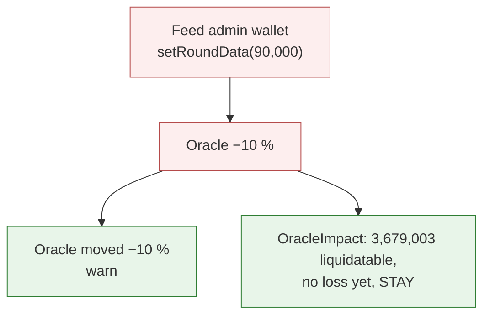

> **Speaker notes (35 s):** riskdep also notes that the oracle now differs from DefiLlama's market price, because this feed follows the issuer and not a market, and that a further 5 % fall would liquidate the whole market.

---

## 8. The upgrade behind the timelock

Suppose the fund really lost 30 %. The feed refuses anything below 90,000, so Midas must install new code through its 48-hour timelock. riskdep reports the upgrade when it is scheduled, not when it lands: that is the depositor's window to act.

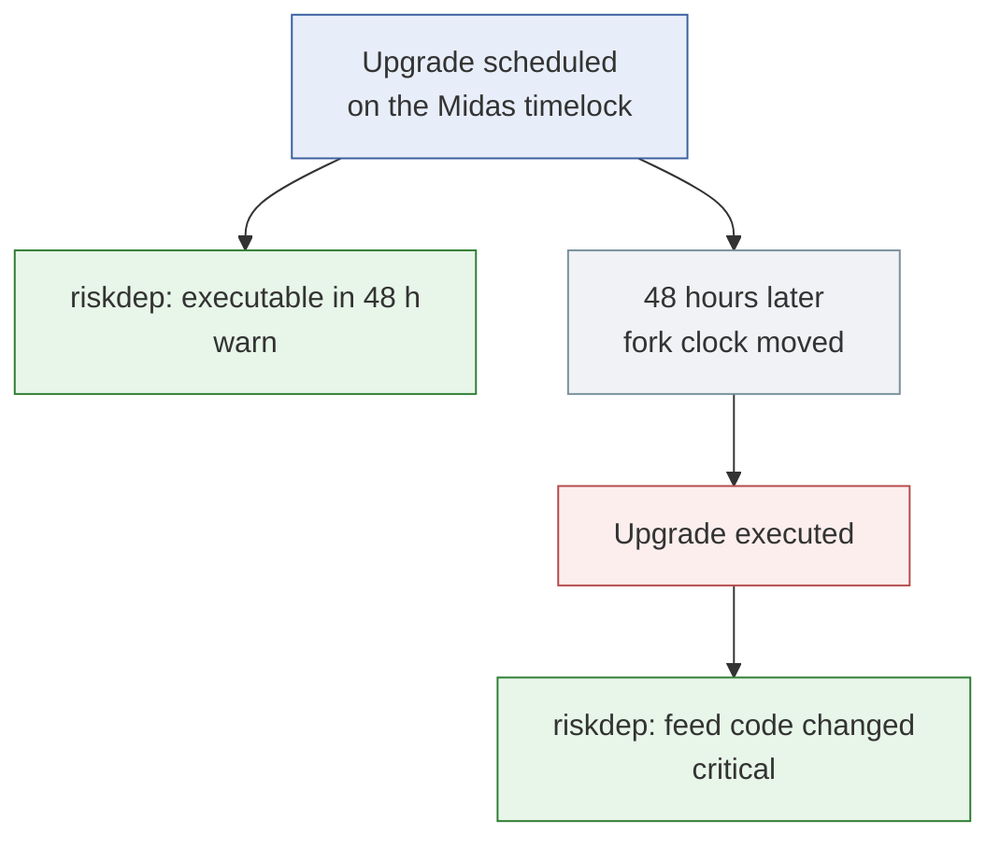

> **Speaker notes (40 s):** Without watching the timelock's queue, the first sign would be the upgrade itself, 48 hours too late. The new code on the fork is a demo implementation, not Midas code: the same interface with a wider band.

---

## 9. The price lands at 70,000

Once the new code is in, the issuer's wallet sets 70,000. The borrower's LTV reaches 0.9995: its collateral no longer covers its debt. Nobody has liquidated yet, so Morpho has not booked a loss, but riskdep counts it at once.

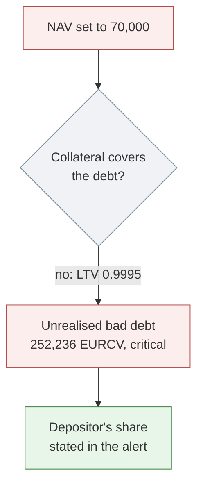

> **Speaker notes (35 s):** Between this block and a liquidation, the vault's share price still reads par, and depositors who leave first pass the loss to the others. The `OracleImpact` alert also states the vault's loss at the new price and the verdict.

---

## 10. Liquidation, and predicted against observed

A liquidator seizes the remaining collateral and Morpho writes the uncovered debt off: the vault's assets fall by 252,914 EURCV. The prediction made before anything happened was 251,761.

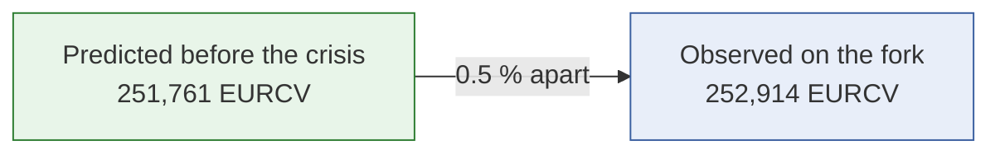

> **Speaker notes (35 s):** The 0.5 % gap is the interest the debt accrued during the 48-hour jump. In the full run, where a first liquidation happens at 90,000, `OracleImpact` stated 215,003 when the price landed and the liquidation realised 217,286, four blocks later.

---

## 11. Running it

One script does everything in one terminal: it builds the two demo contracts, starts the fork, starts the watch in the background, plays the acts, prints what riskdep saw under each act, and stops everything at the end. The watch's side also replays offline from a recording.

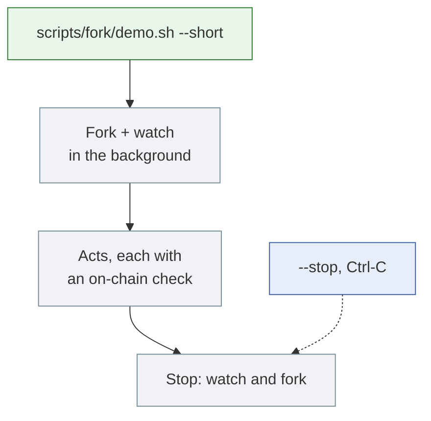

> **Speaker notes (30 s):** `--record` saves the run with asciinema; `--manual` waits for Enter between steps. The offline replay is `riskdep watch --vault 0xD6d4… --replay --record-as fork-belem`, and a test pins its alert sequence.

---

## 12. Limitations

The crisis is played, not observed, and the demo depends on free infrastructure.

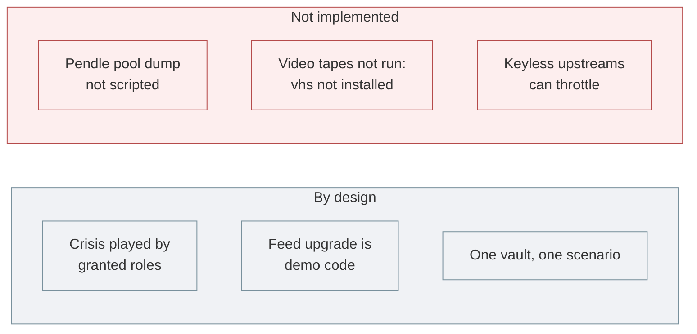

> **Speaker notes (30 s):** Three alternative crises are scripted: a RedStone feed rewritten by a 2-of-3 Safe, unbacked PST minted through a CCIP pool, and PT-fxSAVE reaching maturity. After many forks in a row, the keyless upstream answers 429; anvil now retries with a back-off.

---

## 13. Conclusion

On real mainnet state, riskdep found the fragile point from the vault address alone, predicted the loss before the crisis, warned 48 hours before the upgrade landed, counted the loss the moment the price fell, and matched the realised loss within 0.5 %.

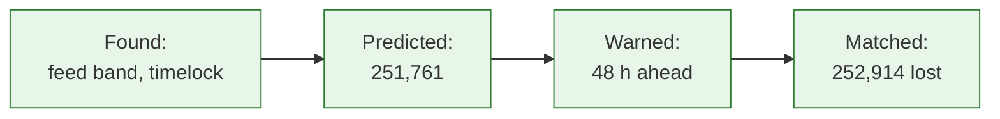

> **Speaker notes (30 s):** Line-by-line explanation of the output: `scripts/fork/DEMO-EXPLAINED.md`. Design and decisions: `docs/analysis/FORK-PRESENTATION.md` and `plan/2026-10-11-fork-demo.plan.md`.
