# Where riskdep's probabilities come from

**Hack base rates, registry priors, the breakeven p\* and outside views**

Ryan Sauge · v1.0 · 2026-10-11

Talk length: about 7 minutes (12 slides, 25 to 45 seconds each)

Source: `docs/model/how-probabilities-are-computed.md`, `docs/model/how-risk-is-computed.md`, `riskdep/priors.py`, `riskdep/registry.json`, `docs/analysis/GAP.md`, `docs/analysis/EXTERNAL_SOURCE.md`

---

## 1. Where riskdep's probabilities come from

A simulation turns probabilities into losses; it does not produce them. This talk follows each probability riskdep uses back to its origin, and shows what replaces a probability when none can be defended.

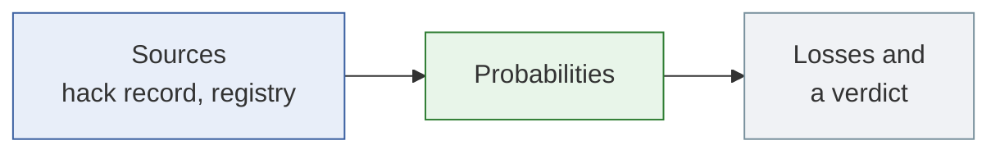

> **Speaker notes (25 s):** The numbers are those of the offline demo: the largest borrower of the Morpho Blue market PT-sUSDE-26NOV2026 / USDC, data of 2026-10-10.

---

## 2. Two questions, two probabilities

riskdep asks two different questions. "How likely is an incident?" needs a prior per dependency, which drives the simulation of `analyze`. "How likely must this incident be for leaving to pay?" needs no prior: it gives a breakeven probability p\* and lets the reader judge. Outside prices are shown next to it, never used.

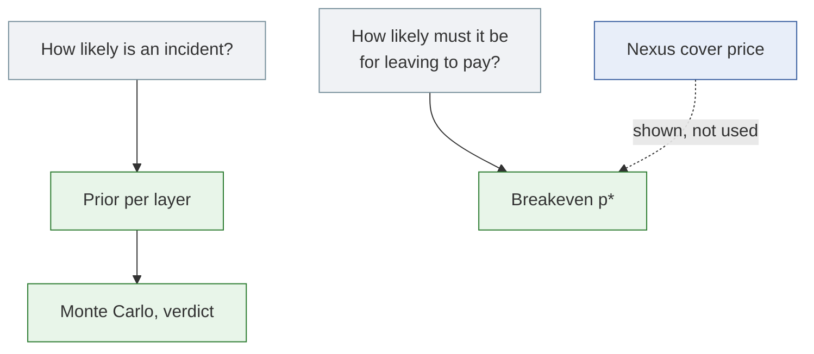

> **Speaker notes (35 s):** The first question suits a position held for a month. The second suits a depositor facing a specific rumour: a fund marking its NAV down, a borrower in trouble.

---

## 3. A position depends on layers

riskdep lists a position's dependencies from the data: the chain, the issuer behind the collateral, the Pendle market of the principal token, the lending market and its oracle. Each layer gets a yearly probability of an incident and a distribution of how bad it is.

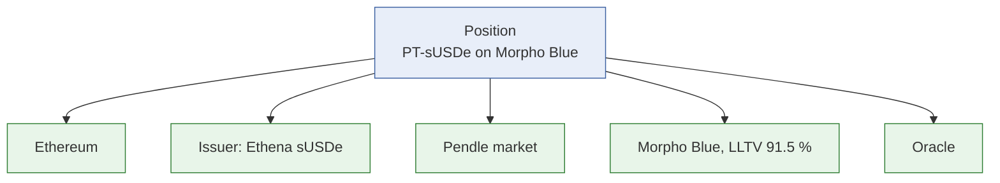

> **Speaker notes (30 s):** The issuer comes from the Pendle market's underlying, looked up in the registry. An unknown issuer gets a conservative default rather than none.

---

## 4. Exploit prior: the formula

For the issuer, Pendle and Morpho, the probability of an exploit comes from DefiLlama's hack record over five years. It multiplies three factors and is kept between 0.5 % and 15 % a year: the hack rate of protocols of the same size, a category multiplier kept between 0.5 and 2, and an age factor of 2, 1 or 0.7.

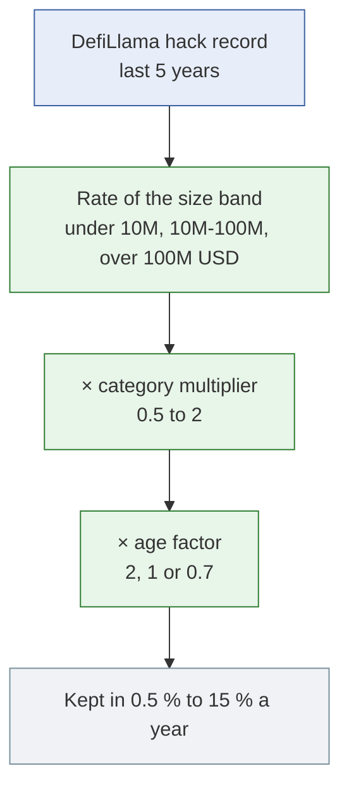

> **Speaker notes (40 s):** The size band comes first for a reason: an earlier version used the category rate alone and gave Morpho Blue 15 % a year, the cap, because the lending category is full of small forks that are hacked often. Every parameter sits in `registry.json` with its reason.

---

## 5. Exploit prior: the demo's numbers

All three demo protocols are in the top size band, where 34 hacks among 256 protocols over five years give 2.66 % a year. The category and age factors then separate them.

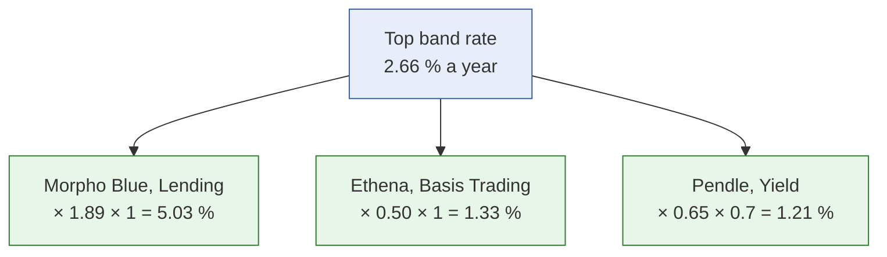

> **Speaker notes (30 s):** Ethena sits at the floor of the category multiplier, 0.5. Pendle gets the 0.7 of a protocol listed more than three years ago.

---

## 6. Oracle and market events

The oracle's prior counts only the exploits that apply to it: misconfigured, stale or predictable oracles, 24 over five years across 179 protocols, 2.68 % a year, doubled if its source is not verified. A depeg is not an exploit: its probability, size and recovery are judgements written in the registry with their reason.

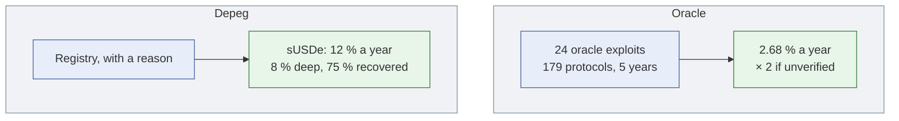

> **Speaker notes (40 s):** Spot-price manipulation of a thin token is the most common oracle exploit, and it cannot move a principal-token oracle that reads a time-based discount, so it is not counted. The sUSDe depeg's basis is the cascade of 2025-10-10, when USDe traded near 0.65 on one exchange while on-chain pools held. An unidentified issuer defaults to 15 % a year.

---

## 7. Severity and horizon

How bad an incident is follows a Beta law between 0 and 1, whose mean is a ÷ (a + b). A yearly probability becomes a probability over the horizon, 30 days by default, under a constant hazard: one minus the chance of no incident over that fraction of a year.

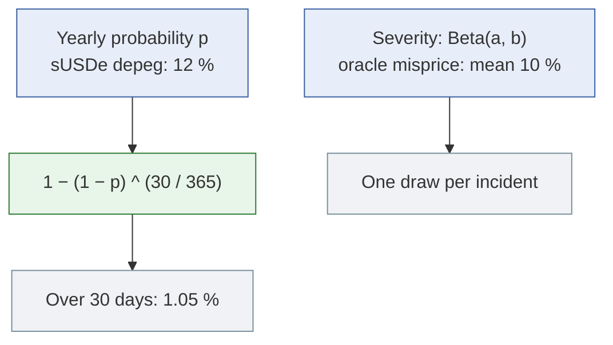

> **Speaker notes (35 s):** Over 30 days, the demo's priors are: sUSDe depeg 1.05 %, Morpho exploit 0.42 %, oracle misprice 0.22 %, Ethena 0.11 %, Pendle 0.10 %, Ethereum 0.08 %. The oracle misprice uses Beta(2, 18): a 10 % mean with a tail of rarer, larger misprices.

---

## 8. From probabilities to a verdict

The simulation draws 20,000 months. Each layer fails or not with its 30-day probability, a failure draws its severity, and a model of the position computes the loss, liquidation included. The average loss is compared with what the position earns and with what leaving costs.

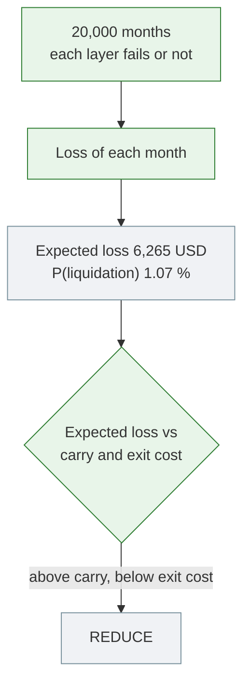

> **Speaker notes (40 s):** The carry is 5,697 USD over the horizon, the exit cost 78,946 USD. The expected loss exceeds the carry, not the exit cost, so the verdict is REDUCE. One dependency is built in: an issuer exploit always comes with a depeg; otherwise the layers fail independently. The sampling itself is in `docs/model/monte-carlo.md`.

---

## 9. Breakeven p\*: when no prior is defensible

A prior cannot say how likely this issuer is to mark this fund down this month. riskdep turns the question around: from the loss if the depositor stays, the loss if it leaves first, and the certain cost of leaving, it computes the probability at which both choices cost the same.

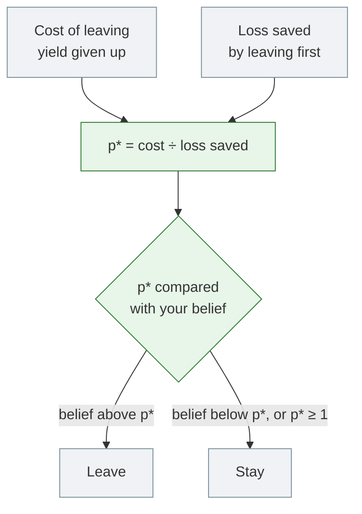

> **Speaker notes (45 s):** Two cases. The f(x) vault under a 30 % fxSAVE markdown: p\* is 7.92 % over 30 days. The Belem vault's largest depositor holds 99.5 % of it: leaving forgoes 2,229 EURCV of yield and saves only 383, so p\* is above 1 and it stays whatever the odds. For a book of vaults, act first on the lowest p\*.

---

## 10. Outside views

An insurance price is an expected payout plus a loading for capital and margin. riskdep converts a Nexus Mutual cover price into an implied yearly probability, price ÷ (loading × severity), with a loading from 2 to 5, and shows the range next to p\*. On depegs the outside views roughly agree with the registry; on exploits they do not.

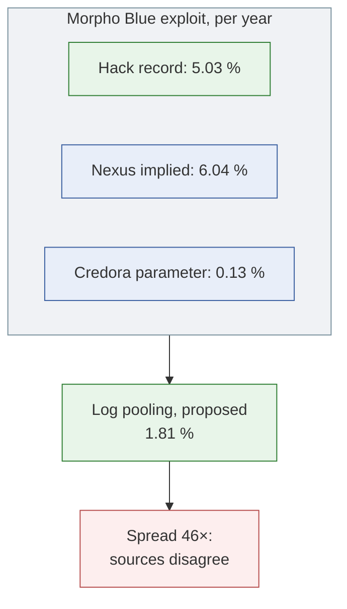

> **Speaker notes (40 s):** With a loading of 3, Nexus implies about 12.2 % a year for an sUSDe depeg against the registry's 12 %. Log pooling, a weighted geometric mean, is proposed in `docs/analysis/EXTERNAL_SOURCE.md` §7, not implemented: a linear average would let the largest number dominate. Cover pays on an exploit, not on an issuer's markdown or a borrower's default, which is why it is shown and not used.

---

## 11. Limitations

The weakest input is the hack record itself.

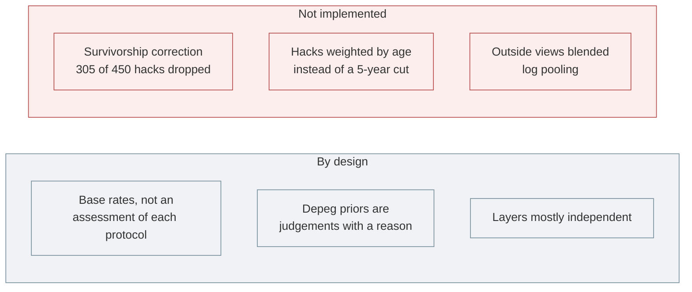

> **Speaker notes (40 s):** The base rate keeps only protocols still above 1M USD: of the 450 hacks with a protocol id, 305 are dropped because the protocol has since shrunk, so every exploit prior is biased low. A 2-year window raises Morpho Blue from 5.03 % to 8.59 % and rests on fewer hacks: more relevant, less reliable. Both are in `docs/analysis/GAP.md` (K1, K17).

---

## 12. Conclusion

riskdep uses three kinds of probability, each for the question it can answer: priors from the hack record and the registry drive the simulation and its verdict; the breakeven p\* replaces them when a specific incident is examined; outside prices are shown as a check. Every number traces to a source and a written reason.

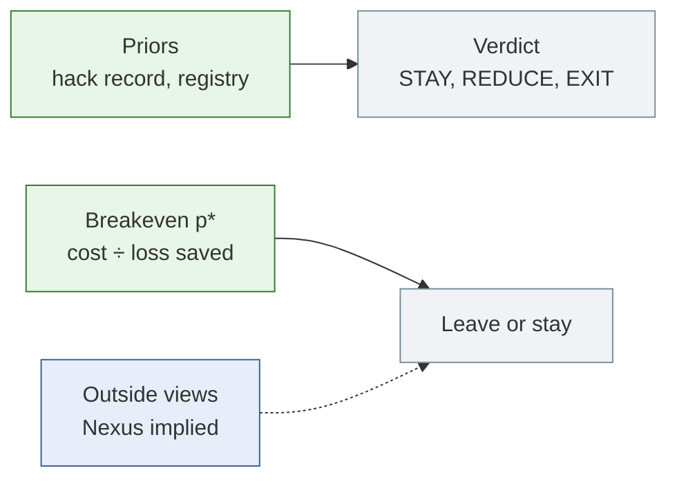

> **Speaker notes (35 s):** The full text, with the formulas, key terms and a FAQ, is `docs/model/how-probabilities-are-computed.md`.
