# riskdep: DeFi risk dependencies

**How a position's dependencies are found, priced, watched and turned into a stay-or-exit decision**

Ryan Sauge · v1.0 · 2026-10-11

Talk length: about 7 minutes (12 slides, 20 to 40 seconds each)

Source: the repository (`README.md`, `docs/README.md`, `docs/analysis/ARCHITECTURE.md`), the DeFi Risk Dependency Challenge brief (Belem Capital, EPFL Hackathon 2026)

---

## 1. riskdep: DeFi risk dependencies

A Python command-line tool, with an HTTP API and a web interface, for the risk of positions on Morpho (Ethereum): what a position depends on, what an incident costs it, how fast, and whether to stay or leave.

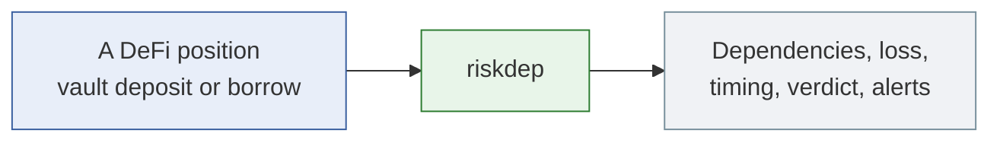

> **Speaker notes (20 s):** Built for Belem Capital's challenge at the EPFL Hackathon 2026. Everything shown today runs on real mainnet data, offline from recordings or live.

---

## 2. The question we answer

A dependency of a position is hit: an oracle, an issuer, a market. How much is lost, how fast does it land, and should the holder stay or exit, given that exiting has a cost of its own? The brief judges discovery (30 %), impact (30 %), decision usefulness (25 %) and a working demo on real data (15 %).

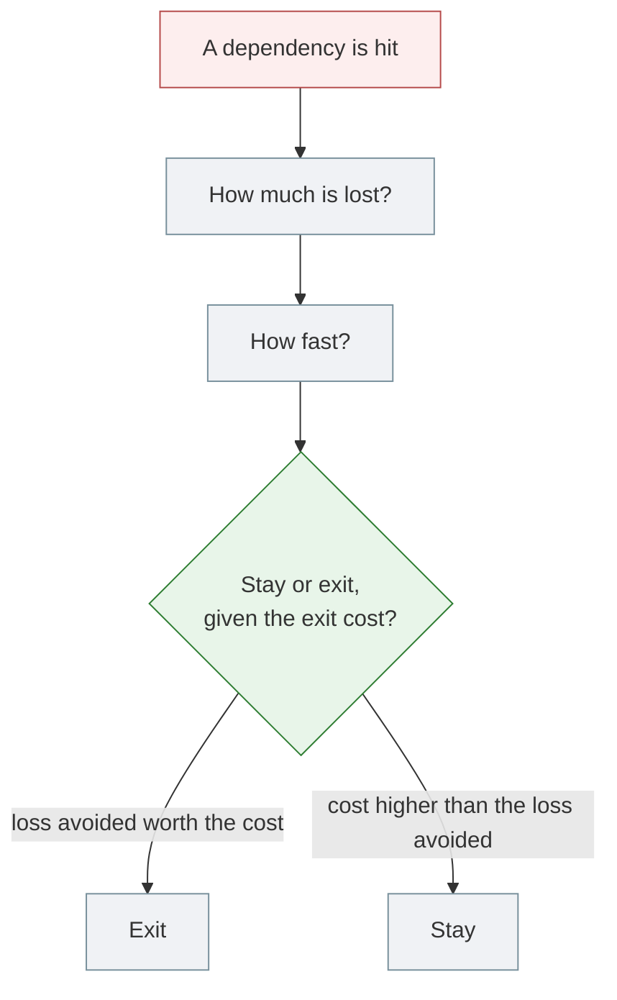

> **Speaker notes (30 s):** The brief's own example: a book in ten 10 % pockets, one is hit, and unwinding costs 11 %. Exiting is certain and costly, staying is cheap and uncertain. Every part of the tool exists to make that trade-off explicit.

---

## 3. One tool, five modes

Five modes share the same sources and modules. `graph` draws the dependencies, `shock` propagates a failure, `analyze` estimates risk and decides, and the two `watch` modes detect incidents block by block. The chain is authoritative: the APIs find positions, every amount is read on-chain.

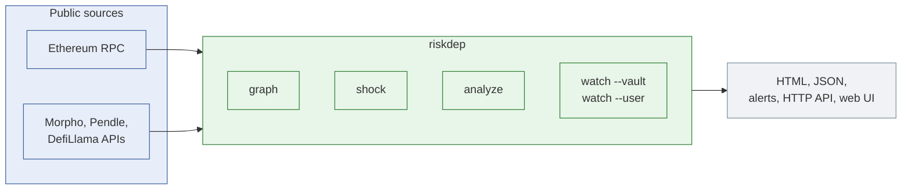

> **Speaker notes (35 s):** No key is needed; Etherscan, Nexus and Pharos are optional. Two cross-checks run in the background: the block hash against a second node, and the Morpho API against the chain.

---

## 4. Dependency discovery

From one vault address, riskdep walks down to everything the money depends on: the markets the vault lends in, their oracles and feeds, the issuers of the collateral, and who can change each contract, up to the timelocks above them. Sibling markets that share a collateral or a price input are added around it.

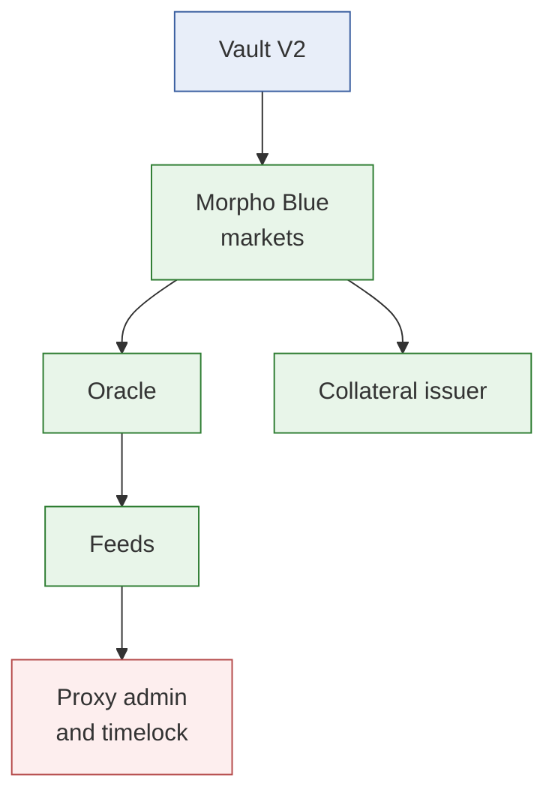

> **Speaker notes (40 s):** Each oracle gets a class: price-tracking, or constant-price when it reports an issuer's rate. That class decides whether a market fall liquidates anyone. On the Belem vault this walk found that one wallet writes the collateral's price, inside a fixed band, and that going below the band needs an upgrade behind a 48-hour timelock.

---

## 5. Probabilities

Each layer gets a yearly probability of an incident. Exploits come from DefiLlama's hack record: a rate for protocols of the same size, times a category multiplier and an age factor, kept between 0.5 % and 15 %. Depegs are judgements written in a registry with their reason. A simulation of 20,000 months turns them into a loss distribution.

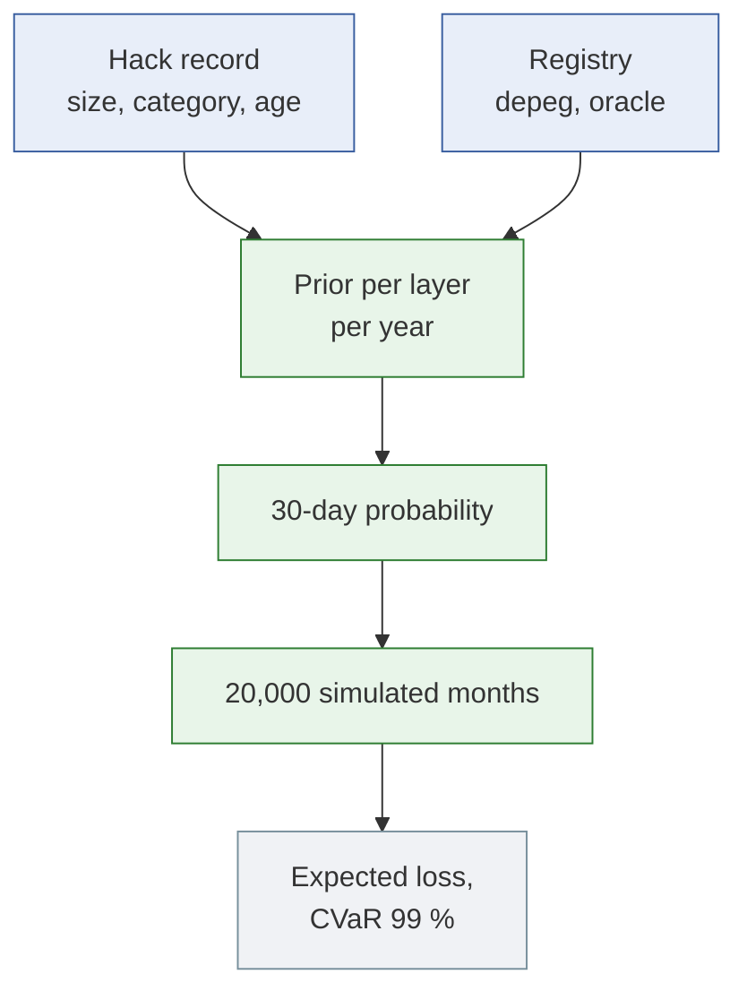

> **Speaker notes (40 s):** For the Morpho Blue market of the demo: 34 hacks among 256 large protocols over five years gives 2.66 % a year; the lending multiplier brings Morpho Blue to 5.03 %. The demo position ends on REDUCE: a 6,265 USD expected loss against 5,697 USD of carry. Details in `docs/model/how-probabilities-are-computed.md`.

---

## 6. Impact: the shock engine

When a node fails (an oracle reads low, a collateral falls, a feed freezes), the shock engine re-evaluates every borrower of every market it reaches, applies Morpho's own liquidation and bad-debt rules, and carries the effect along the graph until nothing moves. The output is a loss per market, per vault and per depositor.

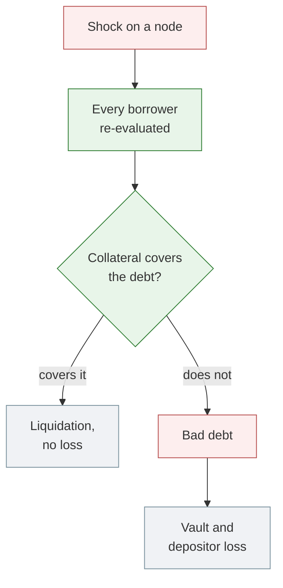

> **Speaker notes (40 s):** The engine is pure, with its transmission rules in the registry or in a file you pass. Example from the README: fxSAVE marked down 30 % leaves 2,284,812 USDC of bad debt in its market, and the f(x) vault takes its share.

---

## 7. Decision: when does leaving pay?

Given the incident, riskdep compares the depositor's loss if it stays with its loss if it leaves first, against the certain cost of leaving. The ratio is a breakeven probability p\*: leave if you believe the incident is more likely than p\*. A Nexus cover price, converted to an implied probability, is shown next to it, never used.

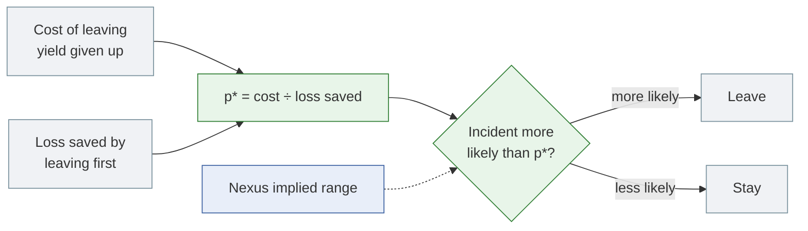

> **Speaker notes (40 s):** Two cases from the recordings. The f(x) vault under a 30 % fxSAVE markdown: leaving pays above 7.92 % over 30 days. The brief's ten-pocket example: leaving costs 110,000 USD for sure against 53,445 saved, so stay. For a book, act first on the vault with the lowest p\*.

---

## 8. Detection: watch

The watcher reads every new block, two blocks behind the head, with three detectors: events (liquidations, upgrades, mints, governance changes), differences between two state reads (oracle moves, bad debt, utilisation), and standing findings at start-up. An incident on-chain is reported about 24 to 36 seconds after its block.

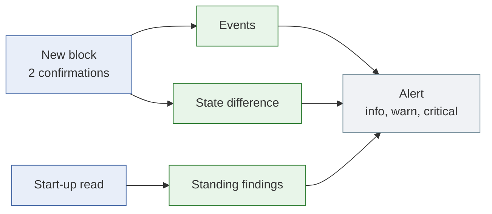

> **Speaker notes (40 s):** When a vault's oracle falls 2 % or more, the `OracleImpact` alert already states the vault's loss at the new price, what is liquidatable, the depositor's loss and the verdict. What each alert means and what to do: `docs/reference/alert-runbook.md`.

---

## 9. Seeing it before it lands

Some signals come before the loss. A feed upgrade queued on a timelock is reported when it is scheduled, a full delay before it can execute. Unrealised bad debt is counted the moment the price lands, before any liquidation books it. On a mainnet fork of the Belem vault, the upgrade was reported 48 hours ahead.

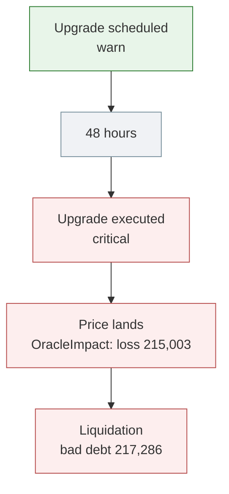

> **Speaker notes (40 s):** The crisis is played on a local fork with the roles that could cause it: the issuer's feed admin, the Midas timelock, a liquidator. `scripts/fork/demo.sh --short` runs it in two minutes. The loss stated when the price landed was 1.1 % from the loss realised four blocks later.

---

## 10. Is the number defensible?

Two checks against reality. A backtest replays the PT-reUSD liquidations of 2026-08-25: from the state 60 blocks before, with the oracle's observed fall, it predicts the same 13 positions and 35.46M USDC liquidatable, against 35.19M repaid. On the fork, a 30 % markdown was predicted at 251,761 EURCV of loss before the crisis; 252,914 was lost.

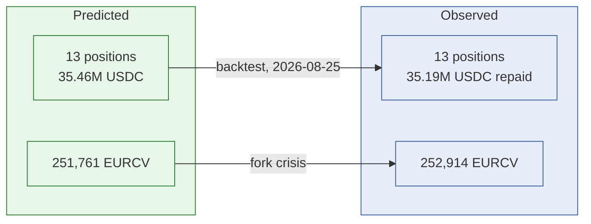

> **Speaker notes (35 s):** The backtest tests the impact given the incident, not the oracle's fall itself, which is an input. The 0.5 % gap on the fork is the interest accrued during the 48-hour time jump.

---

## 11. Limitations

The design trades some coverage for numbers that can be checked; other gaps are on the roadmap.

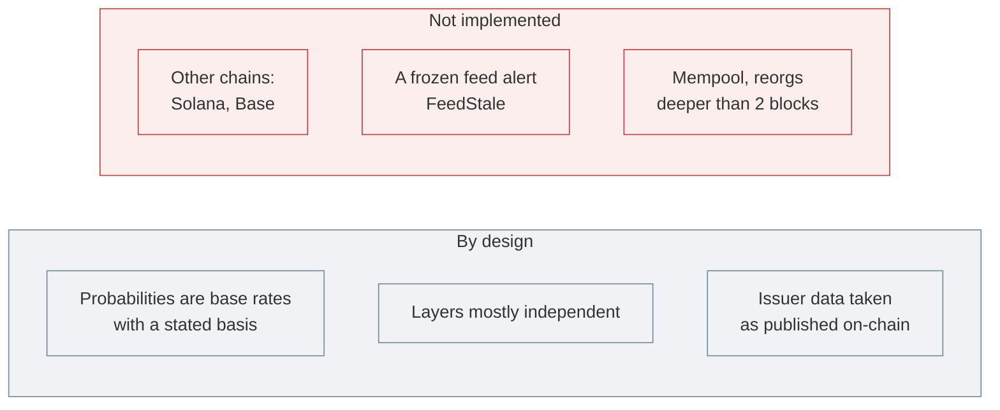

> **Speaker notes (30 s):** The hack record is biased low by survivorship: a protocol a hack destroyed leaves the sample. `docs/analysis/GAP.md` lists that and the other known weaknesses, with what each would take to fix. `analyze`'s Monte Carlo covers Pendle PT collateral on Morpho Blue only.

---

## 12. Conclusion

riskdep answers the brief's question end to end on real data: it finds what a position depends on, prices an incident, states how fast it lands and whether leaving pays, and watches for it live. Every threshold sits in a registry with its reason, and 327 offline tests replay recorded mainnet runs.

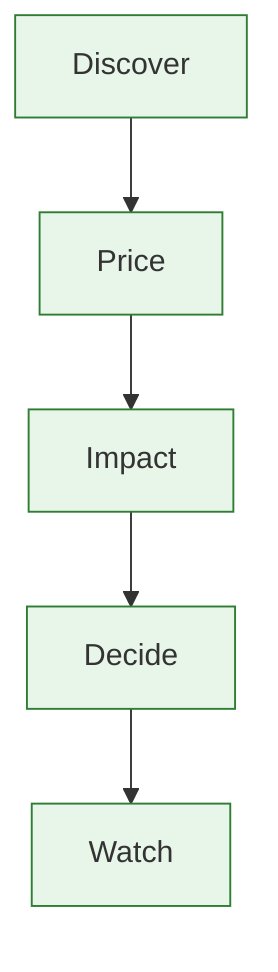

> **Speaker notes (30 s):** To try it: `uv sync`, then the three commands of the README's "answer in five minutes", or `scripts/fork/demo.sh --short` for the live crisis. The documentation index is `docs/README.md`.
